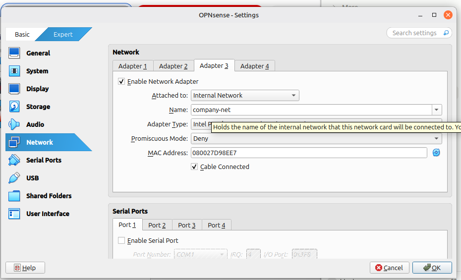
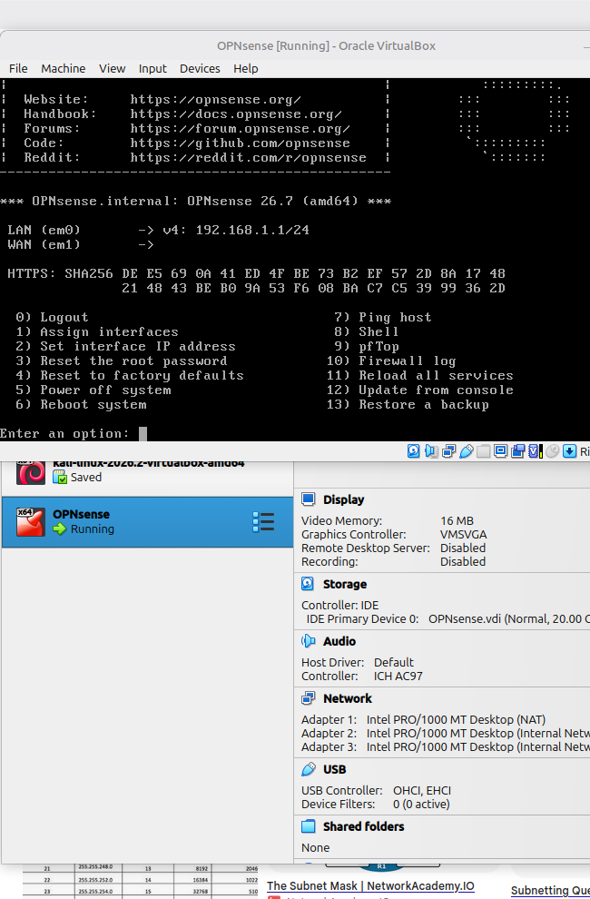
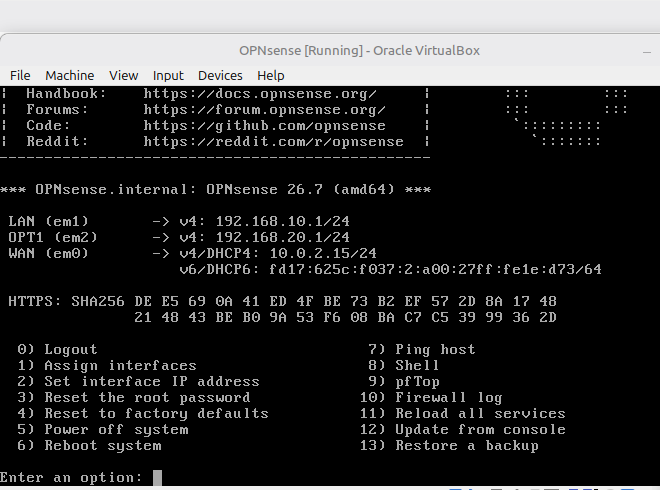
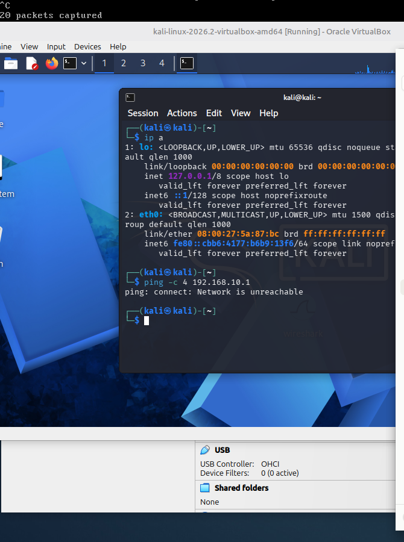
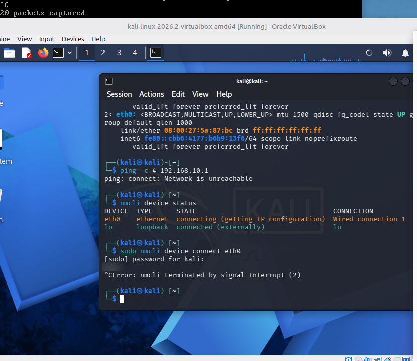
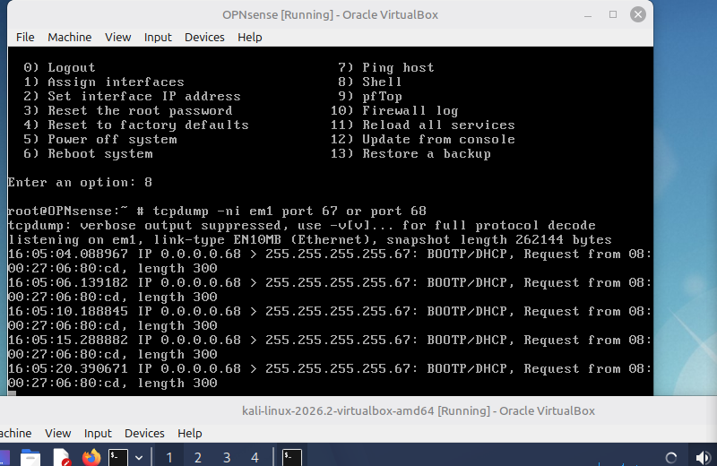
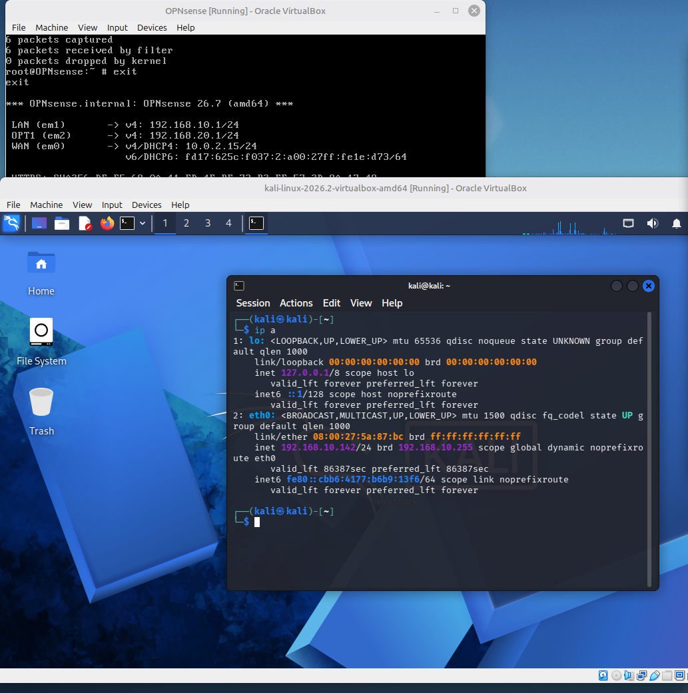
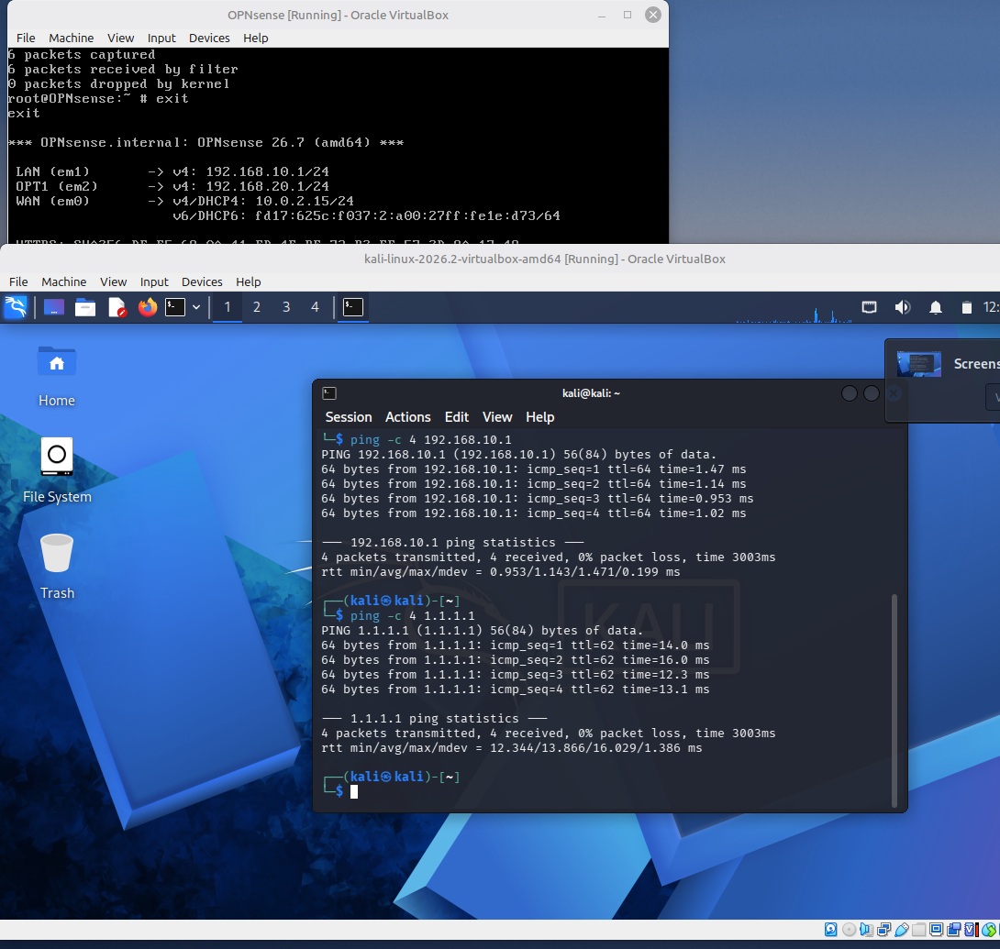

# Lab 01: Building a segmented network with OPNsense

Date: 13 October 2026

## Goal

Install the OPNsense firewall in VirtualBox and use it to split my homelab into separate networks, so that an attacker machine and a company server can't simply talk to each other.

| Network | Purpose | Subnet | Gateway (OPNsense) |
|---|---|---|---|
| WAN | Way out to the internet (VirtualBox NAT) | 10.0.2.0/24 | Gets 10.0.2.15 by DHCP |
| LAN (`attacker-net`) | Kali, the attacker machine | 192.168.10.0/24 | 192.168.10.1 |
| OPT1 (`company-net`) | Ubuntu Server, the "company" machine | 192.168.20.0/24 | 192.168.20.1 |

## Choosing and downloading OPNsense

I chose OPNsense because it's free and open source, has a web interface with built-in logging, and is a firewall that real businesses use.

From https://opnsense.org/download/ I selected:

- System architecture: amd64
- Image type: dvd
- Mirror location: one near me

I used the dvd image because it's an ISO file, and VirtualBox boots a VM from an ISO as if it were a real disc.

## Setting up the VM's network adapters

In VirtualBox I gave the OPNsense VM three network adapters:

| VirtualBox adapter | Attached to | Becomes in OPNsense |
|---|---|---|
| Adapter 1 | NAT | WAN, the way out to the internet |
| Adapter 2 | Internal Network `attacker-net` | LAN |
| Adapter 3 | Internal Network `company-net` | OPT1 |




None of them are set to Bridged. Bridged would connect the VM directly to my real home network, which I don't want once I start running attacks.

## Problem 1: WAN and LAN were the wrong way round

On first boot, OPNsense assigned LAN to em0 and WAN to em1.



Why this was a problem:

- em0 is plugged into NAT (the internet side), but OPNsense was treating it as the LAN, the trusted side.
- em1 is plugged into attacker-net, but OPNsense was treating it as the WAN, the untrusted side.
- So the LAN's "allow everything" rule applied to the internet-facing side, and the WAN's "block everything" rule applied to attacker-net, where Kali is.
- OPNsense's DHCP server was handing out addresses on the internet side instead of in attacker-net.
- The WAN is a DHCP client (it asks for an address). Because em1 was labelled WAN, the firewall's card in attacker-net was asking for an address instead of giving them out. You can see this in the screenshot: WAN (em1) has no address. Kali is also a DHCP client, so attacker-net had two devices asking for addresses and nothing handing them out.

On a real network, this would put the trusted, permissive rules on the internet-facing side and lock the internal users out.

The fix: on the OPNsense console I chose option 1, "Assign interfaces". It asked about LAGGs and VLANs, and I said no to both because I didn't need them. Then I assigned:

- WAN → em0 (NAT)
- LAN → em1 (attacker-net)
- OPT1 → em2 (company-net)

I then used option 2, "Set interface IP address", to give LAN 192.168.10.1/24 and OPT1 192.168.20.1/24. Now every label matches the network its card is actually connected to.



## Problem 2: Kali had no IP address



`ip a` shows every network interface and its addresses. eth0 was UP with the link connected (`LOWER_UP`), but it only had an IPv6 link-local address (`fe80::…`), which a device gives itself automatically. There was no IPv4 address, so DHCP had never given Kali one.

`ping -c 4 192.168.10.1` failed with "Network is unreachable". Without an IPv4 address, Kali has no route to that network at all, so the ping never left Kali.



`nmcli device status` showed:

```
eth0  ethernet  connecting (getting IP configuration)
```

So Kali was stuck at the first step of DHCP (Discover): it kept asking for an address and never got an offer back. Forcing a reconnect with `nmcli device connect eth0` just hung on the same step.

### Investigating with tcpdump

Instead of guessing, I checked whether Kali's requests were actually reaching the firewall. On the OPNsense shell I captured DHCP traffic on em1, the attacker-net interface:

```
tcpdump -ni em1 port 67 or port 68
```

- `-n` shows raw IP addresses instead of names
- `-i em1` listens on the attacker-net interface
- `port 67 or port 68` only shows DHCP traffic (67 is the server's port, 68 the client's)



Each line looked like this:

```
IP 0.0.0.0.68 > 255.255.255.255.67: BOOTP/DHCP, Request from 08:00:27:06:80:cd
```

- `0.0.0.0.68` is a client with no IP address yet, asking for one
- `255.255.255.255.67` is a broadcast to any DHCP server
- `08:00:27:06:80:cd` is the MAC address of whoever is asking

Kali's MAC address is `08:00:27:5a:87:bc` (from `ip a`), but every request came from `08:00:27:06:80:cd`. That MAC belongs to the firewall's own em1 card (checked with `ifconfig em1`): it was still running as a DHCP client, left over from when em1 was wrongly labelled WAN.

The important finding was that none of Kali's requests appeared on em1. That proved this wasn't a DHCP setting problem: Kali's traffic simply wasn't reaching the firewall's attacker-net network.

### Root cause and fix

I checked Kali's network settings in VirtualBox and found its adapter was still attached to the default internal network name, `intnet`. In VirtualBox, every internal network name is a separate virtual switch. OPNsense was on the `attacker-net` switch and Kali was on `intnet`, so Kali's DHCP requests went to a switch with nothing else on it.

I changed Kali's Adapter 1 to Internal Network `attacker-net`, then rebooted both Kali and OPNsense. The reboot also cleared the leftover DHCP client on em1.


## Result



After the fix, `ip a` shows `inet 192.168.10.142/24`. The address is marked `dynamic` with a lease of about 24 hours (`valid_lft 86387sec`), which shows it came from the firewall's DHCP server and wasn't set by hand.

### Testing connectivity



- `ping 192.168.10.1` (the firewall): 4/4 replies with TTL 64. TTL (Time To Live) drops by 1 at every router, and Linux/BSD start at 64, so a TTL of 64 means the reply came straight from the gateway with no routers in between.
- `ping 1.1.1.1` (Cloudflare on the internet): 4/4 replies, so traffic is going from attacker-net, through OPNsense, out of the WAN and back.

## What I learned

- Interface labels don't matter if they don't match the physical (or virtual) cabling. Always check which card is plugged into which network before trusting the labels.
- WAN interfaces are DHCP clients and LAN interfaces are DHCP servers. Mixing them up means the firewall asks for addresses on the network it's supposed to be serving.
- In VirtualBox, an internal network is defined only by its name. One wrong name puts a machine on a completely separate switch.
- Capture the traffic before changing settings. tcpdump showed me exactly where Kali's requests stopped, which pointed straight at the cause instead of me guessing at DHCP settings.
- Reading a packet line properly (source, destination, ports and MAC address) is what turned "it doesn't work" into a specific answer.

## Next

Lab 02: connecting the Ubuntu server to company-net (OPT1) and getting DHCP working there.
