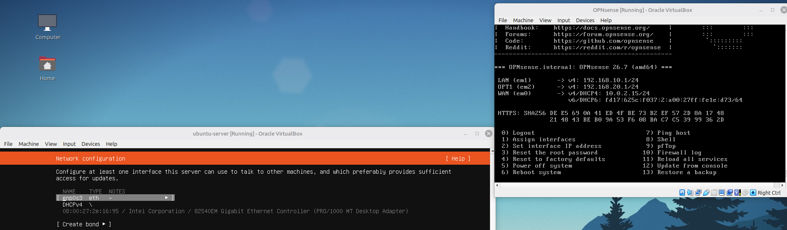
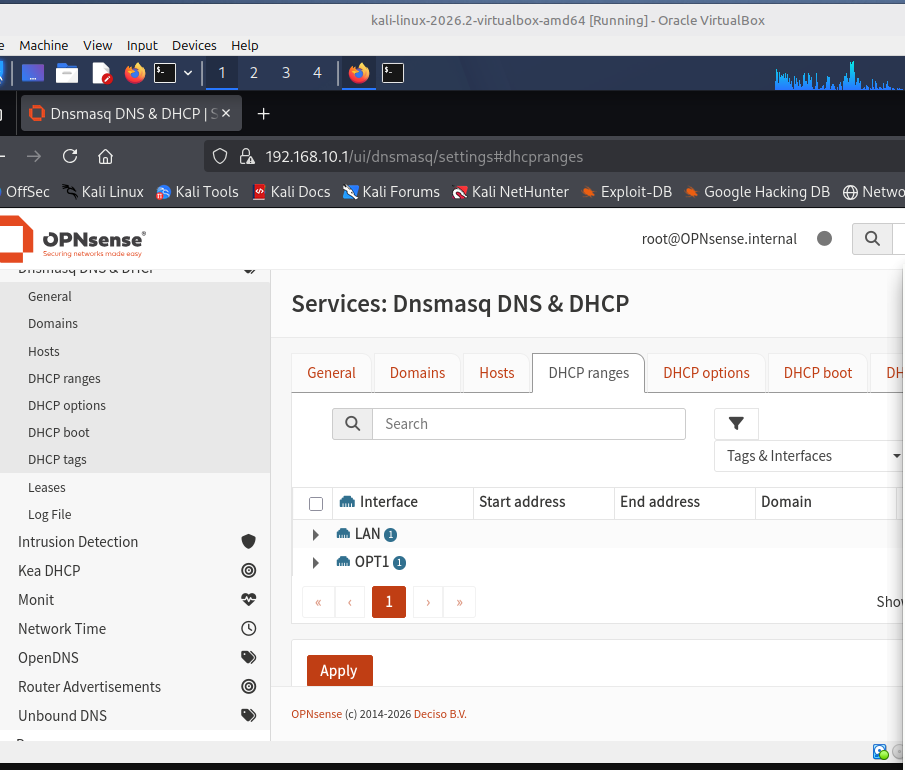
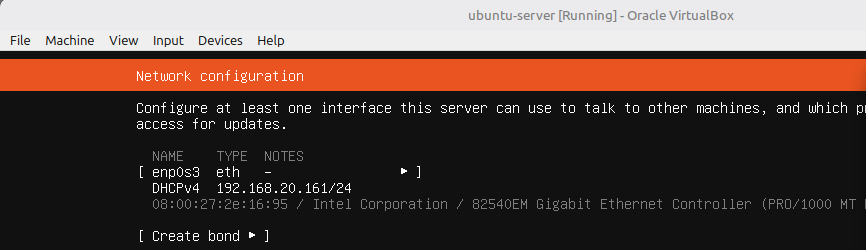

# Lab 03: Firewall rules between attacker-net and company-net

Started 22nd October 2026, finished 24th October 2026

## Today's goal

- Company-net (the Ubuntu VM) must be able to reach DNS and the internet.
- Attacker-net (the Kali VM) must **not** be able to reach company-net.
- Prove both with tests.

## Note: why a large part of this lab was reconstructed

Some of the early work for this lab was done on the 15th of October, right after Lab 02 was finished. However, I ended up losing all my notes from that session, so I couldn't remember what I'd changed.

What I did know was that at the end of Lab 02, Ubuntu couldn't resolve names. This wasn't really a DNS issue. It was the firewall: OPT1 had no rules, so it blocked everything Ubuntu sent, and DNS was just the first thing to fail. Instead of just guessing, I decided I'd use a feature built into the OPNsense website: config history.

- **OPNsense config history** (System → Configuration → History) showed that on **15 Oct 2026 at 18:02 UTC**, `root@192.168.10.142` (me, from Kali) added an OPT1 pass rule, "allow company-net to the internet", below an existing block rule, "blocks the company-net to attacer-net to prevent lateral movement".
- The current rule order and live ping tests confirmed what those rules actually do.

Everything from the 22nd of October onwards was recorded as I went. So lessons learnt: make sure to take screenshots during the lab and not after. I also decided I'd be using an Obsidian vault to store information I might use to document things, with the images alongside them, making things less of a hassle for me.

## Where I started

First, I ran all the VMs: OPNsense → Kali → Ubuntu.

The first test I did was on Ubuntu, to check if Ubuntu was able to reach the internet. I ran `ping -c 3 google.com`, and google.com resolved to 142.250.117.113, with 3 sent, 3 received and 0% packet loss.

This meant that DNS and the internet worked, and the "Temporary failure resolving archive.ubuntu.com" error from the end of Lab 02 was fixed. Next, I went onto the OPNsense website to see how the firewall rules were set.

Under the interface rules, I could see the rules for each network. LAN allowed **LAN network → any**, so Kali could go anywhere, including company-net. OPT1 only blocked OPT1 from being able to access LAN. This was a problem, as the Kali VM was still able to reach the Ubuntu server, which organisations generally try to avoid, as direct access to an organisation's server is a security risk.

To test if this was the case, I went on the Kali CLI and tried to ping the Ubuntu server with `ping -c 3 192.168.20.161`.

All 3 replies came back with 0% packet loss, so Kali could reach Ubuntu. I could also see the TTL (Time To Live, which drops by 1 every time a packet passes through a router) was 63 instead of 64, meaning the firewall had allowed Kali to access the Ubuntu server.

I then pinged the firewall's LAN address (192.168.10.1) from Ubuntu, to test whether company-net could reach attacker-net, using `ping -c 3 192.168.10.1`.

Here the scenario was different: all packets were dropped. The firewall dropped them because of my old configuration which I'd failed to document: **OPT1 network → LAN network = block**.

## Finding the fix I forgot to document

I wanted to find this fix, so I went onto the configuration history. I couldn't understand any of it at first, so I asked Claude AI for assistance.

The page compares two saved versions of the config and only shows what changed. Red lines starting with − are from the old version, green lines starting with + were added, and black lines didn't change. The top two lines show the versions being compared, saved at 18:00 and 18:02 UTC on 15 October.

The big green block is the new rule:
- **action: pass**, **interface: opt1**, **direction: in**: it allows traffic coming in from company-net
- **source: any → destination: any**: company-net can go anywhere
- **log: 0**: it isn't logged
- **description: "allow company-net to the internet"**

The black line above it is my existing block rule, and at the bottom, the username `root@192.168.10.142` shows the change was made by me, from Kali.

So between 18:00 and 18:02 UTC on the 15th, I added a rule letting company-net out to anywhere, placed straight after the block rule.

## Checking the rule order

I went back to the firewall rules and scrolled the table, as there was a hidden rule I'd missed from my first screenshots. This rule was set for OPT1, allowing the Ubuntu server to send packets to anything.

The only reason this didn't take effect in the previous test (Ubuntu not being able to access attacker-net) was because the other rule, OPT1 network → LAN network = block, was a higher priority than the pass rule. The firewall reads the rules from top to bottom and the first one that matches wins, so it used the block rule over the pass rule. If they were swapped, company-net would be able to access attacker-net.

## Building the block rule

I still had to fix the rule which allowed Kali to directly access the Ubuntu server (attacker-net → company-net). I had to block everything from attacker-net going into company-net, while having both of them still be able to access the internet. My plan for this was to block packets from LAN (attacker-net) going to OPT1 (company-net), on the LAN interface because that's where Kali's traffic comes in, and have it be the highest priority rule.

| Interface | Action | Source | Destination | Position |
|---|---|---|---|---|
| LAN | Block | LAN network | OPT1 network | Above the LAN pass rule |

Before the change, this is what it looked like trying to ping Ubuntu and Google from Kali, and Google from Ubuntu:

I added the rule, but it went to the bottom of the list, underneath the LAN pass rule.

I kinda forgot to actually apply the settings, so I pressed the big Apply button that's shaded to make the changes. However, even after this it didn't work. I forgot to move the block rule to the top, which made the pass rule above it favoured and accepted over the block rule.

To fix this, I ticked the block rule, clicked the ← button on the 1st rule and pressed Apply. The block rule is now the first rule for LAN.

## Testing after the fix

After this fix, I reran the test. Kali pinged the Ubuntu server, but got no replies back. This is seen through the 100% packet loss. I then pinged Google from Kali, proving that Kali still has access to the internet, as Google replied. Vice versa for Ubuntu, everything worked.

| Test | Result |
|---|---|
| Kali → Ubuntu | Blocked (100% packet loss) |
| Kali → internet | Works |
| Ubuntu → internet | Works |

## Seeing the block in the firewall log

In order to see the change happen through the firewall log, I went on the OPNsense website and pressed Firewall → Log Files → Live View. In order to see these logs, I had to tick Log on the block rule and apply the changes, because logging is off by default on rules you make yourself.

After pinging Ubuntu from Kali again, three red lines showed up, one for each ping. Each one shows the interface (LAN, in), the protocol (ICMP, which is ping), the source (attacker-net), the destination (company-net), the action (block) and my rule's description. Clicking the ⓘ on a line showed the full details, and the source was **192.168.10.142**, which is Kali's IP.

## What I learned

- The firewall reads rules from top to bottom and the first rule that matches wins, so a block rule has to be above any pass rule that would also match.
- Rules are checked on the interface the traffic comes in through. Kali's traffic is controlled by the LAN rules and Ubuntu's by the OPT1 rules.
- Block drops packets without replying, so ping shows 100% packet loss. Reject sends an error back.
- Nothing changes until you press Apply, and rules you make aren't logged unless you tick Log.
- OPNsense's config history shows what was changed, when, and who changed it.
- Take screenshots and notes during the lab, not after.

## Next

Lab 03b: only allow what's needed instead of blocking everything. I'll put a web server on Ubuntu, allow attacker-net to reach it on port 443 only, and prove the website works while ping and SSH are still blocked.
