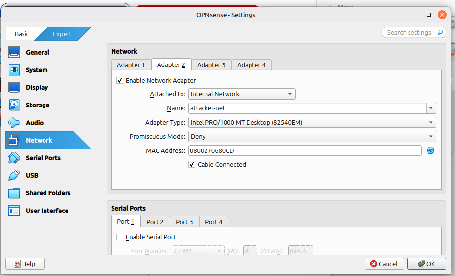
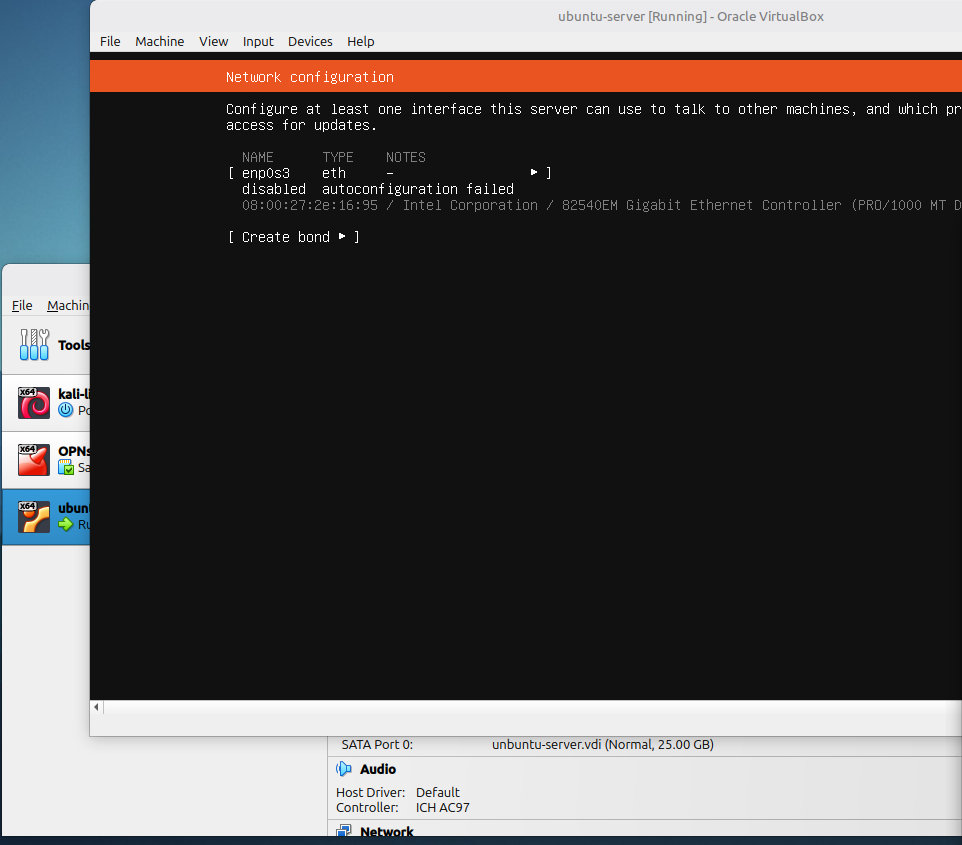

# Lab 02: Building the company server

Today, I'm going to build a small pretend company on my VM that I'll be attacking, and then catching that attack.

I installed Ubuntu Server from ubuntu.com/download/server, the official Ubuntu site. Again, I selected the .iso file for the same reason I downloaded the .iso for OPNsense: VirtualBox boots it as if it were an installation DVD.

I'm using Ubuntu Server as the company's server. It'll be the victim of attacks, run SSH (a service that lets you log in to its shell remotely over an encrypted connection), record login attempts, and I'll also be breaking it.

## Setting it up

When creating the VM, I gave it 2048 MB of RAM, 2 CPU cores and a 25 GB VDI, which is a virtual hard disk. 25 GB leaves room for the tools I'll install later.

Adapter 1 was set to NAT by default. NAT would give Ubuntu its own route to the internet that skips my firewall completely, so I changed it to Internal Network and named it company-net, the same network as OPNsense's OPT1 interface. I made sure the name matched exactly so the issue from yesterday, where Kali was on the wrong internal network, didn't happen again.

I set the language to English (UK) and selected the standard option for installing the server.

## Problem: no IP address

Next up, the network configuration. This is where today's issue occurred. enp0s3 (en = Ethernet, p0 = PCI bus 0, s3 = slot 3) wasn't being given an IP address. PCI (Peripheral Component Interconnect) is the system on a motherboard that cards like network cards plug into. "Autoconfiguration failed" meant Ubuntu had asked for an address using DHCP and no DHCP server replied.

Without an address I couldn't continue properly, as Ubuntu wouldn't be able to download anything during the install.

I set IPv4 back to Automatic (DHCP) to retry, but it didn't work. I then noticed the OPNsense VM wasn't even running. No DHCP requests were being answered because there was no DHCP server switched on. I started OPNsense, and still nothing happened. I guessed that because I had left it frozen in a saved state, its clock might be wrong and causing problems, so I restarted OPNsense, reset Ubuntu's network configuration to DHCP (Automatic), and still nothing happened. My guess was wrong, so I needed actual evidence.
