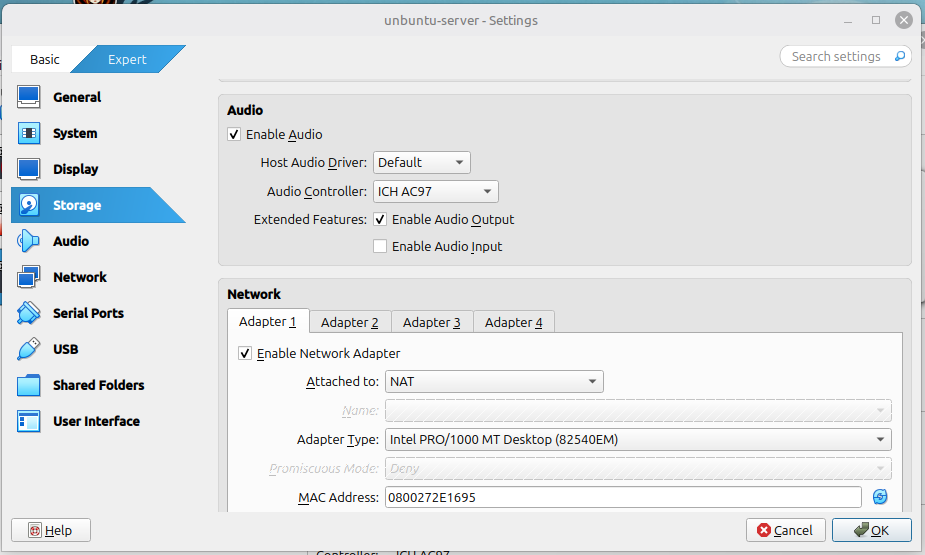
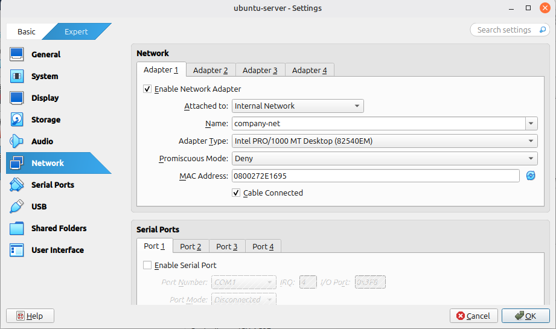
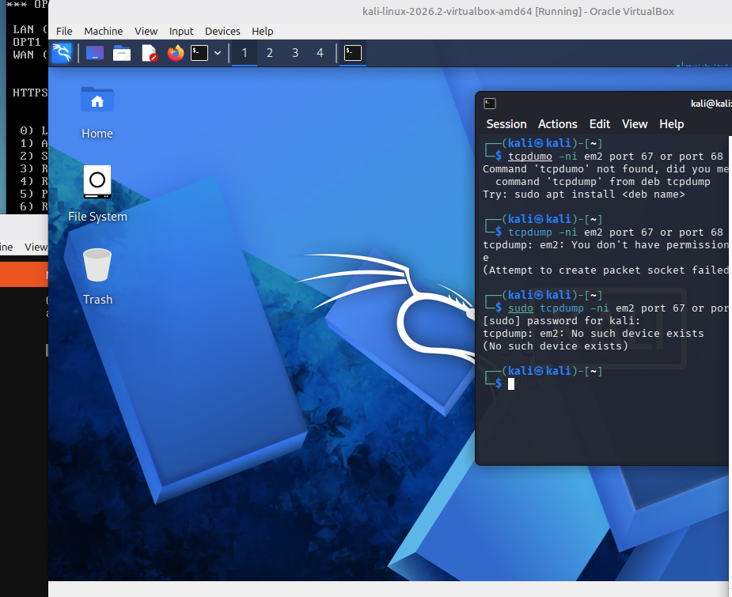
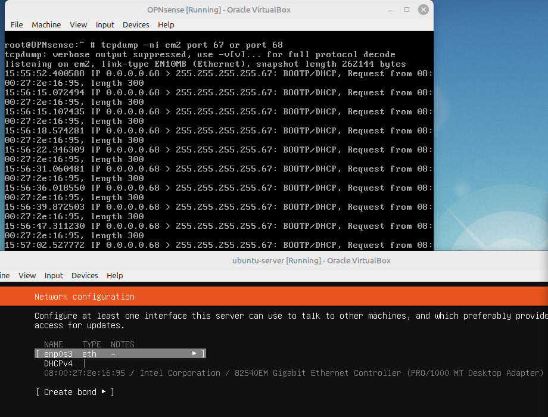
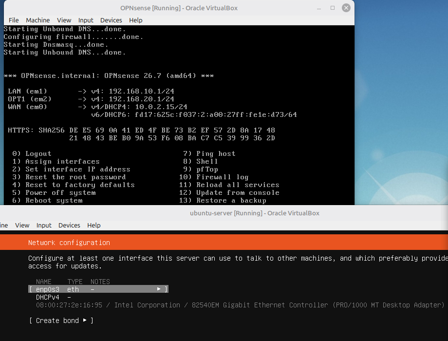
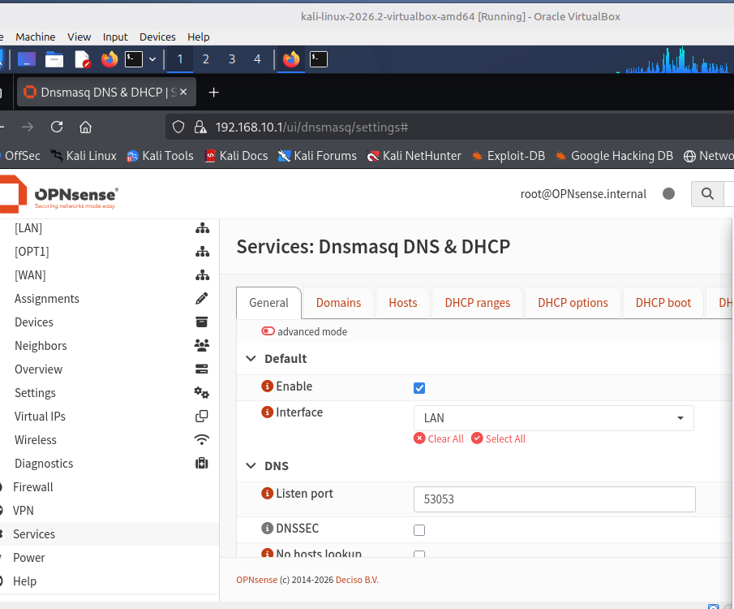
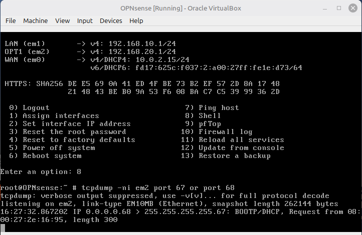
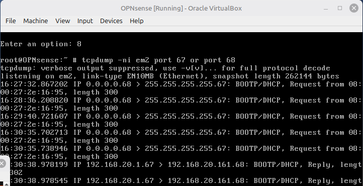
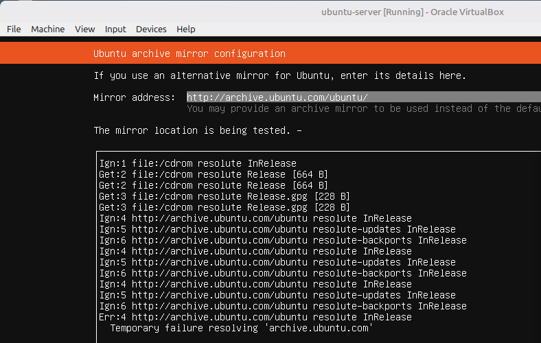

# Lab 02: Building the company server

Today, I'm going to build a small pretend company on my homelab that I'll be attacking, and then catching that attack.

I installed Ubuntu Server from ubuntu.com/download/server, the official Ubuntu site. Again, I selected the .iso file for the same reason I downloaded the .iso for OPNsense: VirtualBox boots it as if it were an installation DVD.

I'm using Ubuntu Server as the company's server. It'll be the victim of attacks, run SSH (a service that lets you log in to its shell remotely over an encrypted connection), record login attempts, and I'll also be breaking it.

## Setting it up

When creating the VM, I gave it 2048 MB of RAM, 2 CPU cores and a 25 GB VDI, which is a virtual hard disk. 25 GB leaves room for the tools I'll install later.



Adapter 1 was set to NAT by default. NAT would give Ubuntu its own route to the internet that skips my firewall completely, so I changed it to Internal Network and named it company-net, the same network as OPNsense's OPT1 interface. I made sure the name matched exactly so the issue from yesterday, where Kali was on the wrong internal network, didn't happen again.



I set the language to English (UK) and selected the standard option for installing the server.

## Problem: no IP address


Next up, the network configuration. This is where today's issue occurred. enp0s3 (en = Ethernet, p0 = PCI bus 0, s3 = slot 3) wasn't being given an IP address. PCI (Peripheral Component Interconnect) is the system on a motherboard that cards like network cards plug into. "Autoconfiguration failed" meant Ubuntu had asked for an address using DHCP and no DHCP server replied.

Without an address I couldn't continue properly, as Ubuntu wouldn't be able to download anything during the install.

I set IPv4 back to Automatic (DHCP) to retry, but it didn't work. I then noticed the OPNsense VM wasn't even running. No DHCP requests were being answered because there was no DHCP server switched on. I started OPNsense, and still nothing happened.

I guessed that because I had left it frozen in a saved state, its clock might be wrong and causing problems. So I restarted OPNsense and reset Ubuntu's network configuration to DHCP (Automatic), and still nothing happened.

I tried running `tcpdump -ni em2 port 67 or port 68` on my Kali VM, which didn't work because Kali's card is eth0, and it isn't connected to em2, as it's on attacker-net and not company-net. That was silly of me.



So I ran it again on OPNsense, which is connected to the Ubuntu server, the internet and the attacker. It showed the following:



Every line said:

```
0.0.0.0.68 > 255.255.255.255.67: BOOTP/DHCP, Request from 08:00:27:2e:16:95
```
The requests came from 08:00:27:2e:16:95, which is the MAC address shown in the Ubuntu VM's network settings. That proved Ubuntu's requests were in fact reaching the firewall, so the network was fine. The problem was the DHCP server not answering.

## Root cause

First I tried the easy fix. On the OPNsense console I chose option 11, "Reload all services", which restarted Dnsmasq along with everything else. Dnsmasq is a program that runs inside OPNsense and hands out IP addresses (DHCP). Ubuntu still didn't get an address. A restart only reloads the same settings, so this told me the problem was in the configuration, not a glitch.




OPNsense also hosts a web page inside itself, which is a control panel for the firewall. I opened it from Kali at https://192.168.10.1 and went to Services → Dnsmasq DNS & DHCP.

First I checked the DHCP ranges tab. A DHCP server needs a pool of addresses for each network, so if OPT1 had no range, Dnsmasq would have nothing to give Ubuntu. There were two rows, LAN and OPT1, each with one range. So OPT1 had addresses ready, and the ranges weren't the cause.


I then checked the General tab. Here, the issue was that the Interface setting only had LAN selected. This setting decides which network cards Dnsmasq listens on. Ubuntu's requests were arriving on em2 (OPT1), but Dnsmasq was only listening on em1 (LAN), so it never heard them.



This is why tcpdump could see the requests but nothing answered. tcpdump copies packets straight off the network card, so it sees everything that arrives. Dnsmasq only receives what arrives on the cards it's listening on. The requests reached the firewall, but they never reached the DHCP service.

It was set to LAN only because LAN was the only internal network when I installed OPNsense. I added OPT1 later in Lab 01, and adding an interface doesn't switch on services for it automatically.

## The fix

On the General tab, I added OPT1 to the Interface setting next to LAN and clicked Apply. Apply rebuilds Dnsmasq's settings and restarts it, so it started listening on em2 as well.

To prove it worked, I ran the same tcpdump command on OPNsense:




From 16:27 to 16:30 there were only requests. About 3 seconds after I applied the fix, replies started appearing:

```
192.168.20.1.67 > 192.168.20.161.68: BOOTP/DHCP, Reply
```

192.168.20.1 is OPNsense's OPT1 address, and port 67 is the DHCP server. It was giving Ubuntu the address 192.168.20.161 on port 68, the DHCP client port.

## Result


Ubuntu got the address 192.168.20.161/24 from the OPT1 range.



The installer then failed with "Temporary failure resolving archive.ubuntu.com". Resolving means turning a name into an IP address, which is DNS. OPT1 has no firewall rules yet, and OPNsense blocks anything that isn't allowed, so Ubuntu's DNS requests were blocked. DHCP still worked because OPNsense automatically allows DHCP on interfaces where it's switched on. Fixing this with firewall rules is Lab 03.

## What I learned
- Adding a new interface doesn't turn on services like DHCP for it, you have to do it yourself.
- Capturing traffic before and after a change proves the fix worked instead of guessing.
