# Lab 04: Wazuh SIEM

Started 31st October, finished 3rd November 2026

For this lab, I'm building a SIEM tool. A SIEM (Security Information and Event Management) tool collects logs from every machine on the network and flags anything suspicious, like failed SSH logins.
I'll be using Wazuh, as it's free and open source.

## The plan

- **Lab 04 (this one):** build the Wazuh server.
- **Lab 04b:** build a separate management network and an analyst PC, so I can open the Wazuh dashboard safely.
- **Lab 05:** connect company-srv01 to Wazuh and watch its logs arrive.

## Where Wazuh goes on the network

Before building anything, I had to decide where Wazuh would sit on the network. It can't go on LAN, because that's where Kali (the attacker) is, and that would defeat the point. The attacker shouldn't be able to reach the SIEM.
Instead, I put it on company-net, on its own VM, because security tools belong next to the servers they're protecting.

## Why not just install it on company-srv01?

I thought about installing Wazuh straight onto company-srv01, then looked into why you shouldn't:

1. **If company-srv01 gets hacked, the attacker gets the logs too.** That means they could delete or change the logs to hide what they did, getting rid of the evidence.
2. **Port 443 is already taken.** Wazuh's dashboard uses port 443, and nginx already uses port 443 on company-srv01. Two services can't listen on the same port on the same machine, so it wouldn't have worked in the first place.
3. **It wouldn't fit.** When I created company-srv01, I only thought about nginx and the minimum it needed. Wazuh needs 4 CPUs and 8 GB RAM, and company-srv01 only has 2 CPUs and 2 GB RAM.

## Getting the right Ubuntu

When I started, I hadn't realised that Wazuh 4.14 doesn't support my version of Ubuntu (26.04.1). It only supports up to Ubuntu 24.04. I had to use the direct link to download 24.04.5:

```
https://releases.ubuntu.com/noble/ubuntu-24.04.5-live-server-amd64.iso
```

Then I created the new VM.

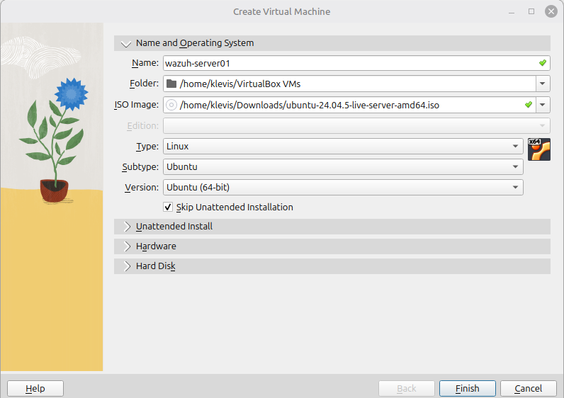

## Creating the VM

I gave it 8192 MB of RAM and 4 CPUs, which is Wazuh's minimum for an all-in-one install. My laptop has 32 GB of RAM, which is the only reason I'm able to run all these VMs at once.

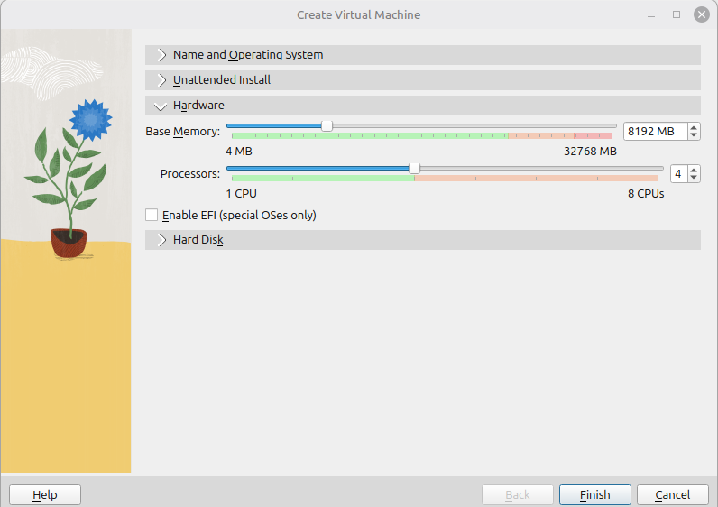

I gave it a 50 GB VDI (VirtualBox Disk Image), which is Wazuh's recommendation for storing about 90 days' worth of alerts. I didn't pre-allocate it, so the file only grows as data is written, instead of taking 50 GB off my laptop straight away. I was running out of storage when making this, so that mattered.

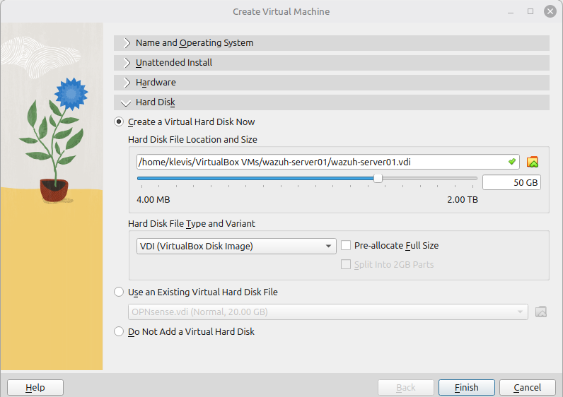

## Network adapter

Adapter 1 was set to NAT by default. NAT would give Wazuh its own route to the internet, which would skip my firewall completely. I changed it to Internal Network and set the network name to `company-net`, the same as company-srv01.

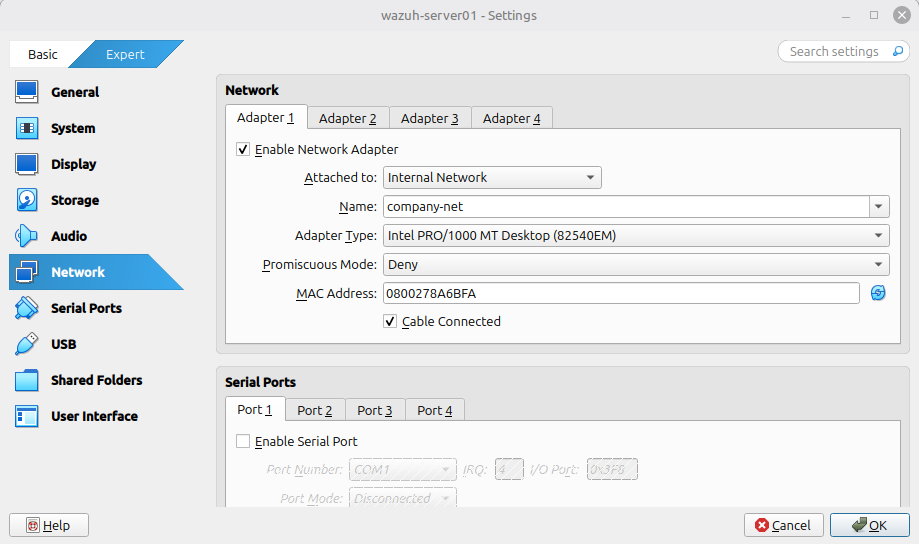

Its MAC address is 08:00:27:8A:6B:FA, which later shows up in OPNsense's DHCP leases and in tcpdump.

## Installing Ubuntu

- **Language:** English (UK)
- **Network:** DHCP (automatic) for now. It should get a 192.168.20.x address.
- **Server name:** `wazuh-server01`. It has to be different from company-srv01, because every log is labelled with a hostname. If two machines had the same name, I wouldn't be able to tell which alert came from which server.
- Ticked **Install OpenSSH server** and skipped the extra snaps.

At the end, the installer asked me to remove the installation medium. In the VM, I went to Devices -> Optical Drives -> Remove disk from virtual drive. If I don't do this, the VM can boot back into the installer when it restarts.

The VM showed **Failed unmounting cdrom.mount**.

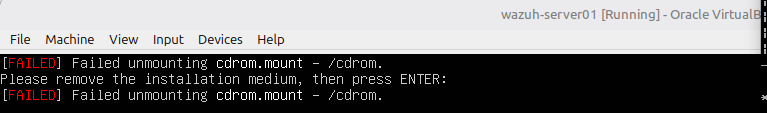

When I checked the storage settings, the optical drive said Empty. VirtualBox had already ejected the ISO, so the error was harmless. I just pressed Enter to reboot.

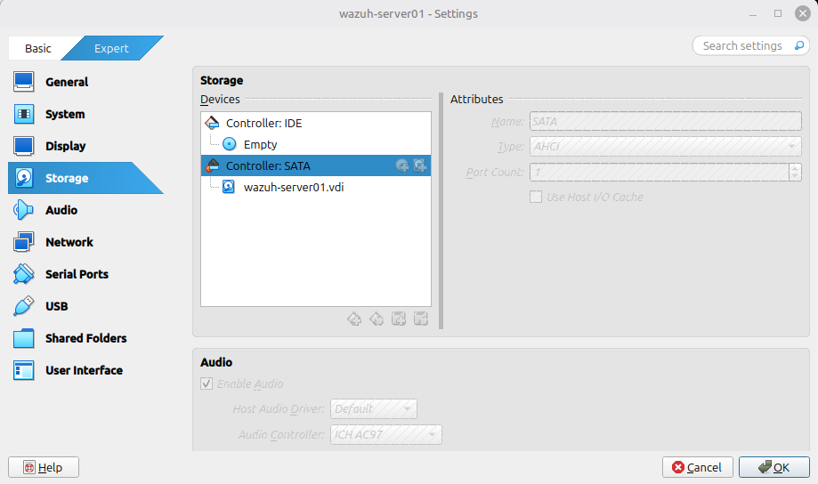

## Booting it for the first time

I logged in as `siemadmin`. The welcome screen already showed the IP, **192.168.20.130**, so DHCP worked and wazuh-server01 is on company-net (192.168.20.x).

To test the whole path out to the internet in one go, I ran:

```bash
ping -c 4 google.com
```

4 packets were sent and 4 were received, with 0% packet loss. One ping to a name proves everything at once: the server has an IP, it can reach the firewall, the firewall lets it out to the internet, and DNS works.

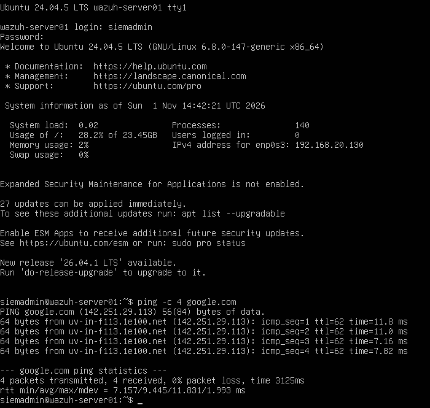

## Can the attacker reach the SIEM?

Before testing, I predicted that Kali wouldn't be able to reach Wazuh at all. My only LAN -> company-net rule lets Kali reach **company-srv01 (.161) on port 443 (HTTPS)**, and everything else is blocked by default.

On Kali, I ran:

```bash
ping -c 4 192.168.20.130
```

100% packet loss, so everything sent to the Wazuh server was blocked. This is what I wanted. The attacker shouldn't be able to reach the security tools, because they could attack them or tamper with the logs.

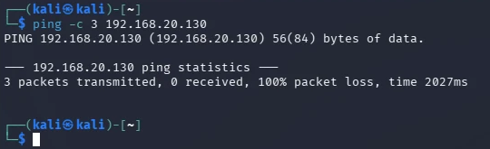

## Giving Wazuh the whole disk

The welcome screen said `Usage of /: 28.2% of 23.45GB`, but I gave the VM 50 GB. I ran `sudo vgs`, which showed **VFree 24.00g** sitting unused. Ubuntu's installer only gives the main volume about half the disk by default. Wazuh stores a lot of logs, so I extended the volume before installing.

I hadn't used LVM (Logical Volume Manager) before, so I looked up how to extend it. My first tries failed because I typed the number `1` instead of `-l` (lowercase L), which look almost the same in the VM's font. I switched to the long option names so there was nothing to mix up:

```bash
sudo lvextend --resizefs --extents +100%FREE /dev/ubuntu-vg/ubuntu-lv
```

- `--extents +100%FREE` adds all the free space in the volume group to this volume.
- `--resizefs` grows the filesystem on it too. Without it, the volume gets bigger but the filesystem can't use the new space.

The volume went from **24 GiB to 48 GiB**.

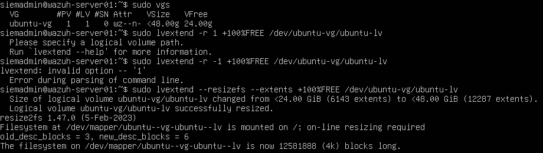

## Installing Wazuh

I installed Wazuh with one command:

```bash
curl -sO https://packages.wazuh.com/4.14/wazuh-install.sh && sudo bash ./wazuh-install.sh -a
```

- `curl -sO` downloads the installer script (`-s` = silent, `-O` = save it under its own name).
- `&&` only runs the installer if the download worked.
- `-a` means **all-in-one**: everything on this one VM.

I had a lot of errors typing this, because there's no copy and paste into the VM's terminal. My first try did nothing at all because of typos, and `curl -s` is silent, so it hid the error. The better way is to SSH into the server from another machine (which is why I ticked OpenSSH), so I can paste commands in.

It took about 7 minutes. It installed three parts, in this order:

1. **Wazuh indexer:** the database that stores the alerts and makes them searchable.
2. **Wazuh server:** receives logs from **agents** (small programs installed on each machine it watches) and checks them against rules to decide what is and isn't an alert.
3. **Wazuh dashboard:** the website I'll use to look at the alerts, on port 443.

It also generated its own certificate for the website, so the dashboard uses HTTPS.

At the end, it printed `User: admin` and a password. The password isn't kept in these notes, and I've covered it in the screenshot.

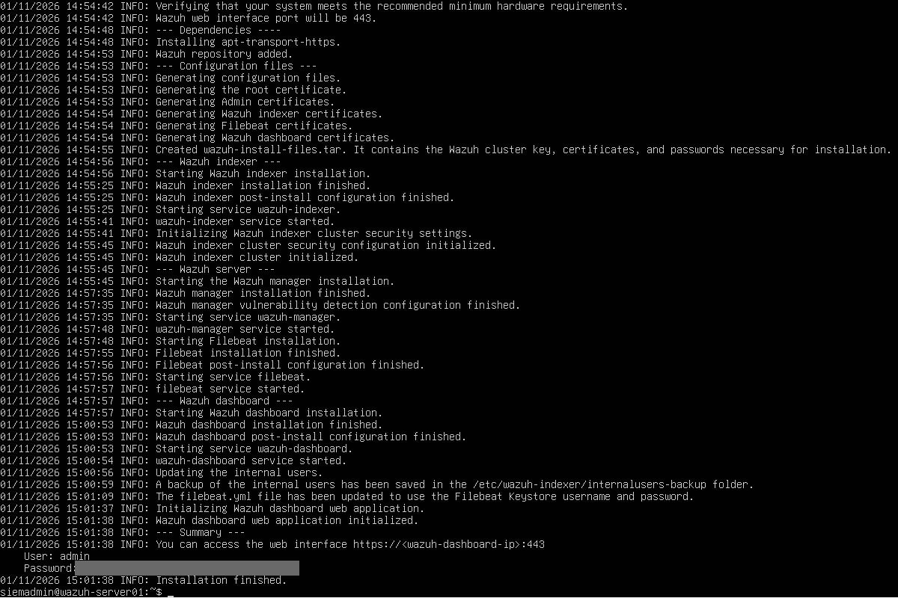

**Mistake:** the first time, I shared a screenshot without covering the password, so I treated it as leaked and changed it. It was also a random string I couldn't remember, which isn't practical.

## Changing the password

I generated a new password in my password manager and used Wazuh's own password tool (shown here with a placeholder, not the real password):

```bash
 sudo bash /usr/share/wazuh-indexer/plugins/opensearch-security/tools/wazuh-passwords-tool.sh -u admin -p 'NEW_PASSWORD_HERE'
```

- The **space at the start** keeps the command, and the password, out of bash history.
- The **single quotes** stop bash treating symbols like `*` and `?` as special characters.
- I used the tool instead of the dashboard because it also updates every service that logs in as `admin`.

I had to type this many times, because the password only accepts certain symbols: `. * + ? -`. I'd have preferred if every symbol could be used.

To check it worked, I ran:

```bash
sudo filebeat test output
```

It returned `talk to server... OK`. Filebeat sends alerts to the indexer as `admin`, so a badly done password change would quietly stop logs flowing into Wazuh.

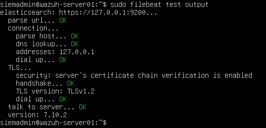

Then I checked the new password itself. curl asks for the password instead of me typing it on the command line, so it never shows on screen or in history:

```bash
curl -k -u admin https://127.0.0.1:9200
```

Typing the new password returned the **cluster info**, which is what the Wazuh indexer sends back when you connect to it. It's a short block of JSON (structured text) with fields like `"cluster_name" : "wazuh-cluster"`. Getting it back proves two things: the indexer is running, and it accepted the new password. A wrong password returns `Unauthorized`. (`-k` accepts Wazuh's self-signed certificate.)

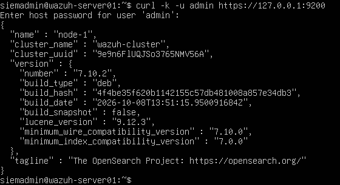

## Why the SIEM needs a fixed IP

Every agent is told the SIEM's IP, so it knows where to send logs. If the IP changed, the agents would keep sending to the old address and the logs would never arrive. Attacks would go unseen, and nobody would notice. Firewall rules that mention the SIEM's IP would break too.

## Making .130 permanent with a DHCP reservation

A **lease** is when a DHCP server lends a machine an IP from its pool for a set time. It's dynamic, so it gives out whatever IP is free, and the same IP isn't guaranteed.

That's why I used a **reservation** instead: whenever that MAC address asks, it always gets the same IP. I chose this over setting the IP by hand on Ubuntu because it keeps every IP in one place (OPNsense). If something is misconfigured, I know to check OPNsense first. OPNsense is also the DHCP server, so it knows never to give .130 to any other machine.

On Kali, I opened OPNsense and went to **Services -> Dnsmasq DNS & DHCP -> Leases**. I found wazuh-server01's row and clicked **+** in the Command column. This opened a host override already filled in with the IP **192.168.20.130** and the hardware (MAC) address **08:00:27:8a:6b:fa**, which is how DHCP knows which device gets the address. I clicked **Save**, then **Apply**. Saving alone does nothing until you apply it.

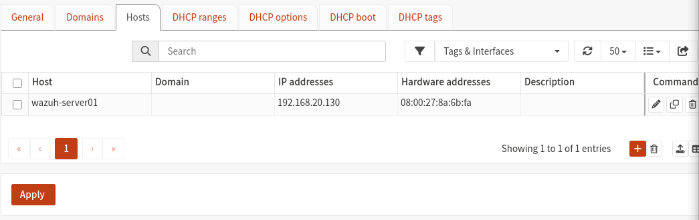

To test it, I ran `sudo reboot` on the Wazuh VM, then `ip a`. It came back as **192.168.20.130** with a fresh lease (`valid_lft 86374sec`, about 24 hours). `ip a` still says `dynamic`, which is normal: Ubuntu still asks DHCP for an address, but the firewall now always answers with .130.

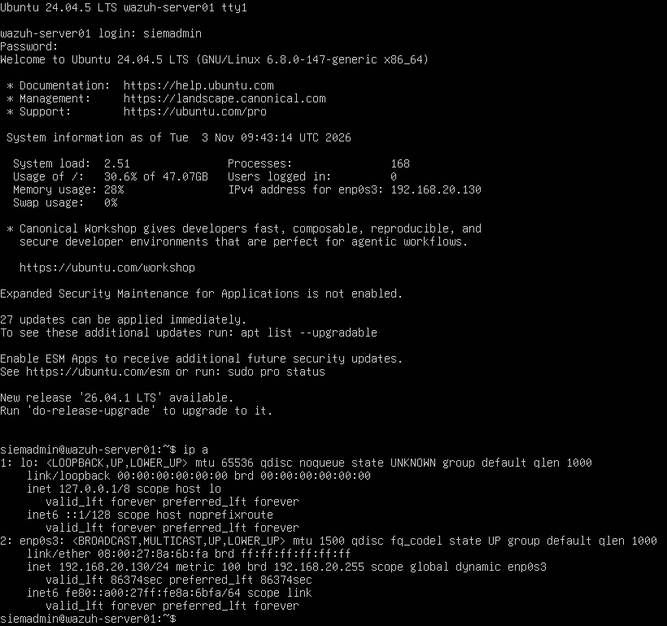

## Opening the dashboard

The dashboard is a website at `https://192.168.20.130`, but none of my machines can open it yet:

- wazuh-server01 is Ubuntu **Server**, so it has no desktop and no browser.
- Kali has a browser, but it's on attacker-net and the firewall blocks it, which is how it should be.
- My laptop, which runs Mint, can't open it either, because it can't see VirtualBox's internal networks.

So in Lab 04b, I'll build an **analyst PC** on its own **management network** instead of company-net, where Wazuh and company-srv01 are. If an attacker hacks company-srv01, they'll scan company-net and try to jump to the next machine (**lateral movement**). If the analyst PC sat on company-net, it would be a target. On its own network, the firewall controls exactly what it can reach. In this case that's only `https://192.168.20.130` on port 443.

## What I learned

- Separating my tools onto their own VMs and networks works really well. Nothing collides, it's easier to find my way around, and it's easier to research one task at a time.
- How to set up a DHCP reservation, which was easier than I expected.
- If a password ends up in a screenshot, a photo or anything else, it has to be changed, no matter what. There's no room for risk or gaps in security.

## Sources

- Wazuh quickstart: https://documentation.wazuh.com/current/quickstart.html
- Wazuh password management: https://documentation.wazuh.com/current/user-manual/user-administration/password-management.html
