# Lab 04b: Creating a SIEM viewer

The dashboard was at https://192.168.20.130 but none of my machines could open it.
company-srv01 and wazuh-server01 are both Ubuntu Server, so they don't have browsers.

Kali is blocked by the firewall, and the attacker shouldn't be able to access the SIEM.

My Mint laptop cannot access or see internal networks.

So, I had to make a new VM to act as an analyst PC with a browser and on its own network. I decided I'd have it be on its own network so that if a hacker were to get into company-srv01, they wouldn't be able to reach the analyst PC through lateral movement and hide themselves. The firewall decides exactly what can cross into analyst-net, and the analyst PC doesn't need the internet, just the SIEM.

## Creating the new analyst PC

First thing I did was turn off OPNsense, because VirtualBox won't let you add a network card while the VM is running.

Then, in VirtualBox, I went on OPNsense -> Settings -> Network -> Adapter 4 -> Enable -> Internal Network and set its name to analyst-net. I wrote down the MAC address in case I needed it for later, which was 08:00:27:66:3D:4E

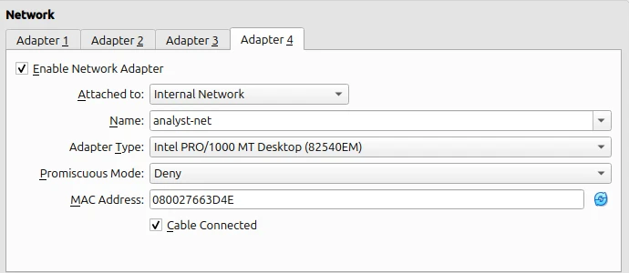

I booted up OPNsense to check the new network I added, and everything was as I'd left it, which is exactly what I wanted. This was to make sure the problem from Lab 01, where my WAN and LAN were the wrong way round, didn't happen again. The new card (which should be em3) isn't listed, as I hadn't enabled nor assigned a new interface.

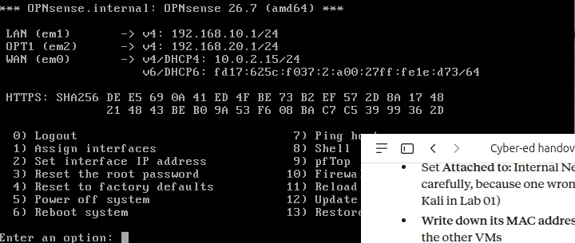

To assign the new interface, I went on Kali's browser to access the OPNsense website. I clicked on Interfaces -> Assignments, and added em3 as opt2. I opened the new ANALYST interface I made and enabled it, set it to IPv4 static, assigned it the ip 192.168.30.1 / 24 and applied the changes I made. 

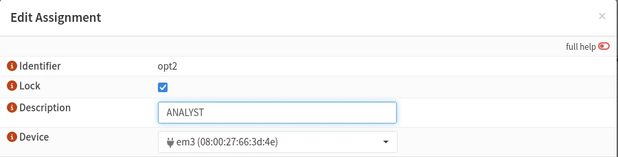

To check that this worked, I went on the overview, which showed ANALYST(opt2) there.

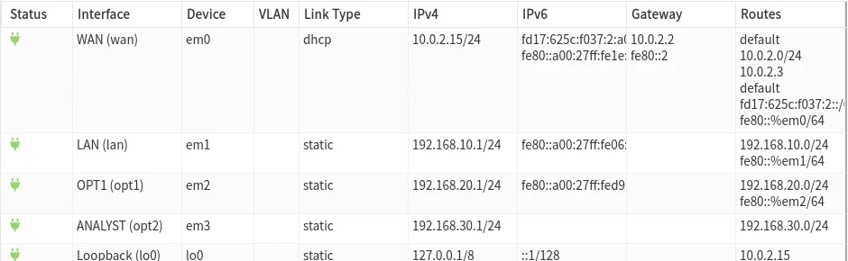

## Setting up the DHCP for analyst net

I went on Services -> Dnsmasq DNS & DHCP -> DHCP ranges, and added ANALYST 192.168.30.100 -> 192.168.30.200 which was the same pattern as LAN and OPT1. On my first attempt of assigning this, I made the range 192.168.30.2 -> 192.168.30.3 which is only 2 addresses.

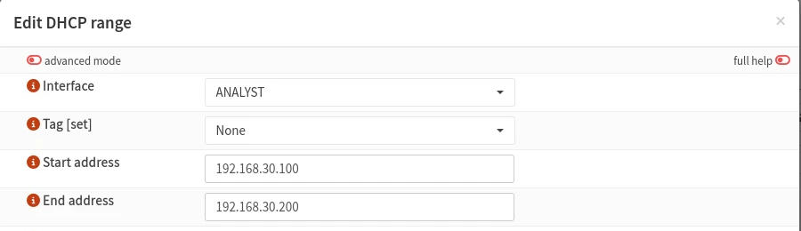

To check if DNSmasq was listening to ANALYST, I went on Dnsmasq -> General -> Interface. It lists  ANALYST, LAN and OPT1, which most likely meant that it was listening to the new ANALYST network.

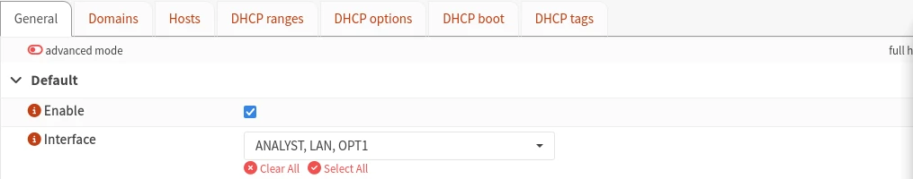

I opened up OPNsense, rebooted it once more, and there I saw the new ANALYST network named em3

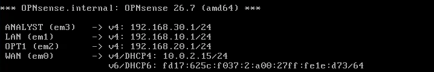

## Blocking company net from reaching analyst net

Before building this rule, I traced a packet from company-srv01 to 192.168.30.150. Rule  block OPT1 -> LAN doesn't match this, but pass OPT1 -> ANY does, which means that company-net might be able to reach the analyst-net, which would be a gap that I'd have to fix as analyst-net had to be its own network, where no one and nothing could reach it.

At first I thought I needed an allow rule that would let the analyst-net be able to receive logs and have logs reach the analyst net. However, this was wrong, as the logs go from company-srv01 to Wazuh, and they're both on the same network. I would only be using the analyst-net to be able to access and view the website that contains the dashboard that my Wazuh server is hosting. What I needed instead was a block rule.
(I forgot to get screenshots for this part, that's my bad)
I went on Firewall -> Rules and OPT1.
I set the rules to: Block IN IPv4 any protocol source: OPT1 network Destination:ANALYST and enabled viewing logs. I moved this rule above the original pass any rule which had been previously set on OPT1.

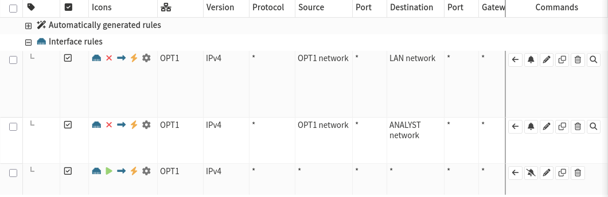 LAN, block -> ANALYST, then pass any" />

So now, this is how the SIEM should get the logs:
1. The Wazuh **agent** on company-srv01 sends logs to the **manager** which is on port 1514.
2. The manager checks them against rules and decides what's an alert.
3. The **indexer** stores the alerts.
4. The **dashboard** is the website that reads the indexer. The analyst PC opens it, but It never receives a log itself.

The rules page showed the LAN block rule below the LAN pass rules. I tested it on Kali instead of trusting the page. First I tried pinging the company-srv01. It was off. I turned it on , retried the ping

ping -c 4 192.168.20.161 
and got 3 packets received.

I ran curl -k 192.168.20.161 
and got welcome to nginx through http. 

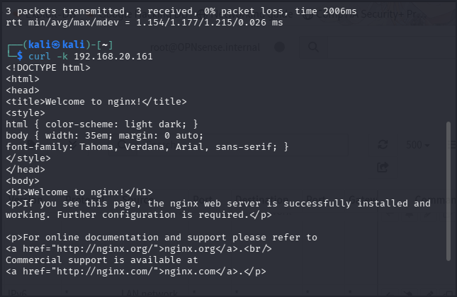

The attacker net was able to completely reach the company-net directly, which is the complete opposite of what was meant to happen. The pass rule was on a higher priority than the block rule, which most likely happened when I was adding priority on the ANALYST rule.

For this fix, I just moved the block rule back up, under the HTTPS rule, so that Kali would still be able to access the server through https.

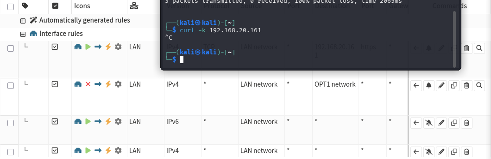 OPT1 back above the pass rules" />

I did a retest on kali to check everything was working, and every result came out as expected.

The more important one was https://192.168.20.161 as it showed kali was still able to access the company server through https.

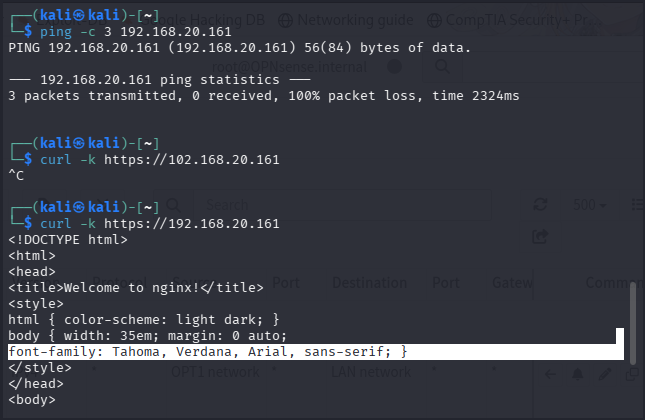

I also did another test on company-net, to see if everything was working as planned on it, and it was perfectly fine.

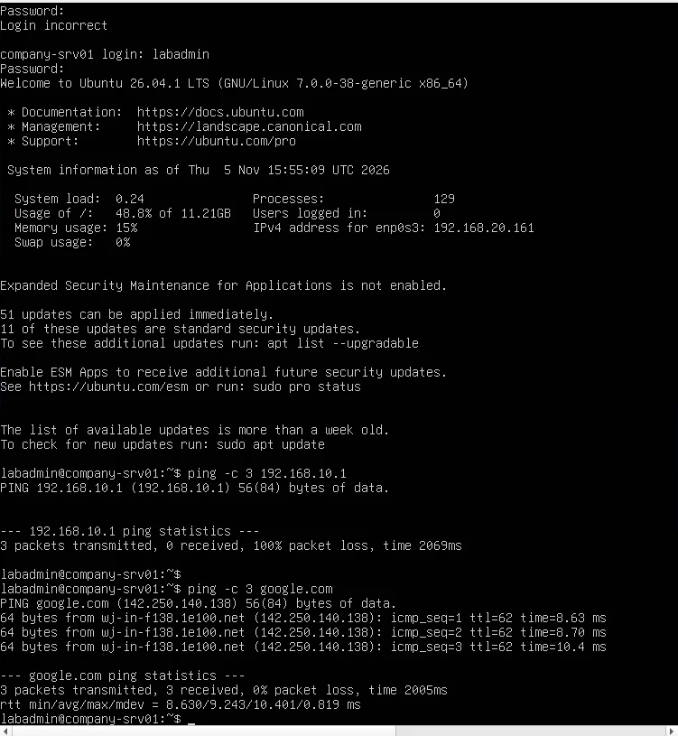

## Building the analyst net

For this VM, I decided I'd use Lubuntu. I got the ISO  from `cdimage.ubuntu.com` as the main site, lubuntu.me was down.

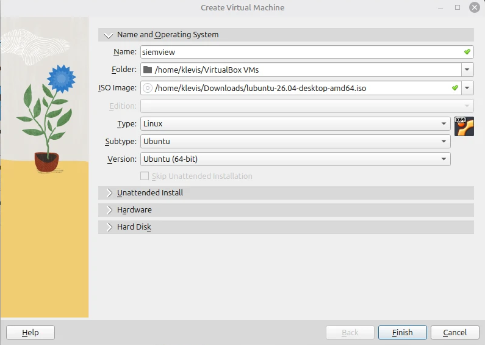

I made the VM name siemview and turned auto login off

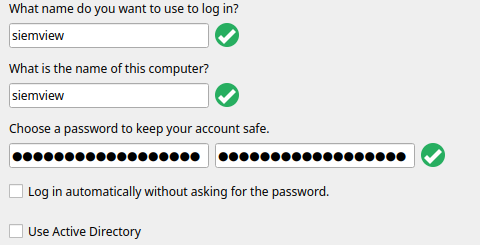

I set adapter 1 to internal network and assigned it to analyst-net.

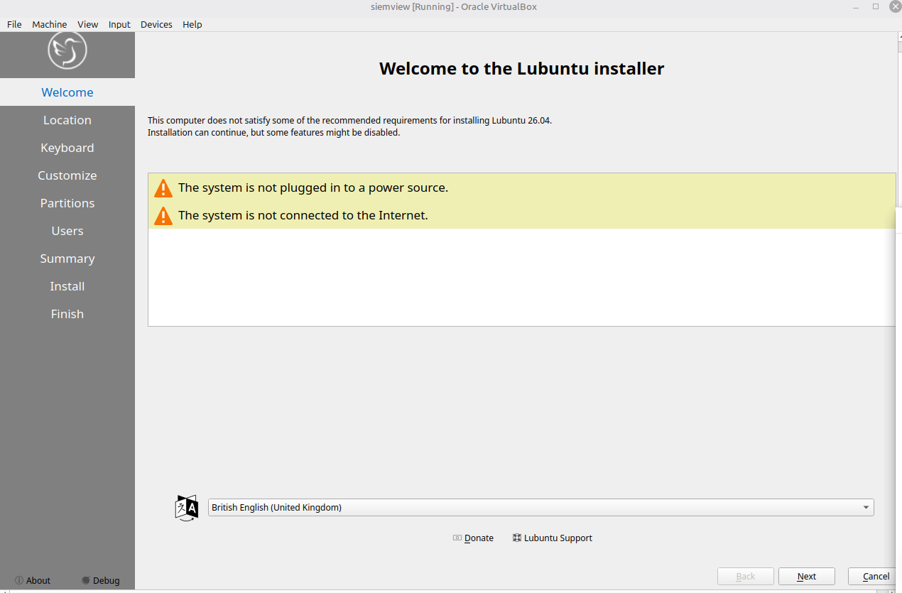

In this screenshot, I picked minimal for a smaller attack surface. It would remove all apps that weren't needed, including a browser which I hadn't known, which later on I'd come into problems with.

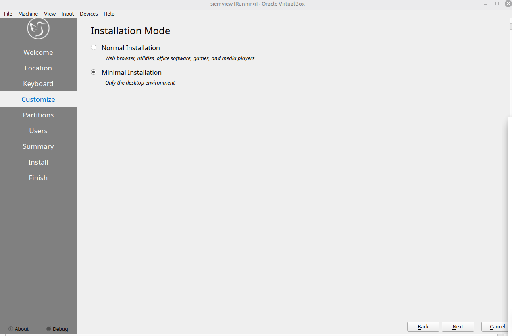

## First test - DHCP analysis

I predicted that siemview would be assigned an IP between the ranges of 192.168.30.100-192.168.30.200.

When I tested ip a, the IP 192.168.30.186/24 was assigned to the mac address **08:00:27:ae:4c:35**, which is the Lubuntu MAC address.

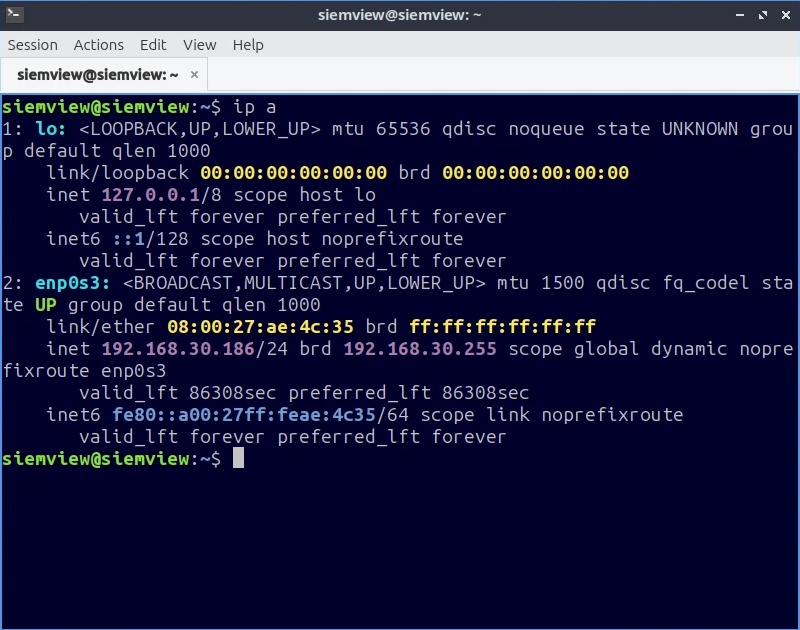

This meant that DHCP worked on the new analyst network without any configurations to the firewall, thanks to the automatic rules that it sets.

The problem I'd come into however, was that I couldn't use a browser to access the Wazuh dashboard.

First, I had to confirm that there was no browser. /usr/share/applications exists on every desktop and holds the app launchers, so I checked if firefox was in there using 
ls /usr/share/applications | grep -i -E "firefox|falkon|chrom". Nothing was returned back, meaning that there were no apps in there.

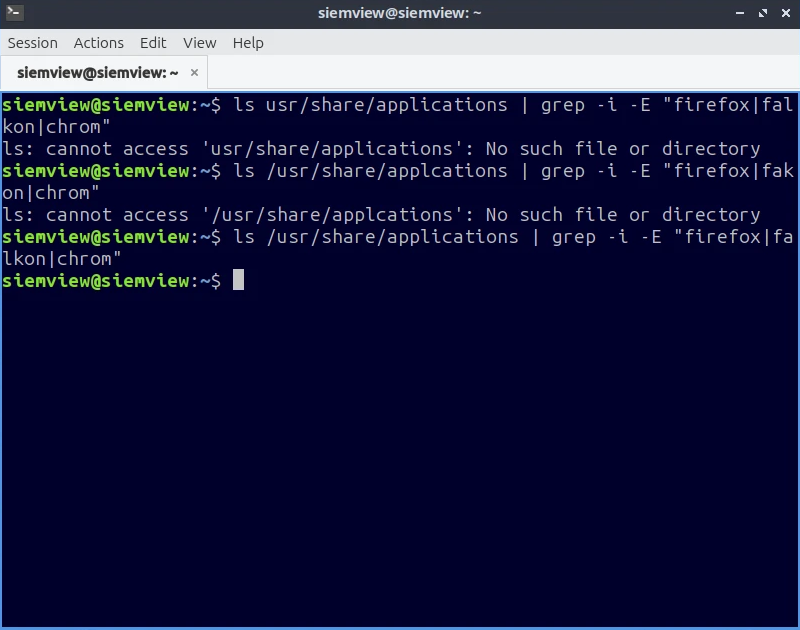

## Installing firefox
In order to install firefox, I had to reconfigure my firewall to allow packets to pass through the analyst-net. Before applying these changes, I created a plan for what I had to do.

Since I only needed the internet to download Firefox, I made the rules temporary. I named each one TEMP so I'd know to turn them off, and my backout plan was to disable them once Firefox was installed, then test that siemview was cut off again.

I made three rules on ANALYST:
- **TEMP DNS:** TCP/UDP, from ANALYST net to ANALYST address (the firewall, which is siemview's DNS server through Dnsmasq), on port 53. This was so siemview could look up names.
- **TEMP HTTPS:** TCP, from ANALYST net to any, on port 443. This was for the snap download.
- **TEMP HTTP:** TCP, from ANALYST net to any, on port 80. This was for apt, because Ubuntu's mirrors use plain HTTP.

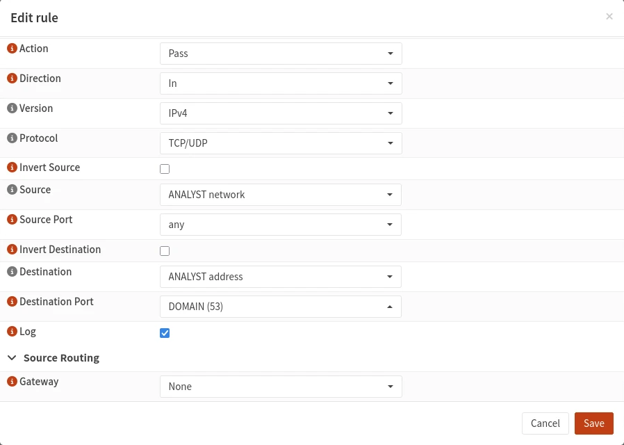 ANALYST address, port 53" />

## Problems
After I'd set the DNS rule, ping failed. However, this should've happened considering ping is ICMP and none of the rules allowed it. Instead, I used nslookup to see if I could reach a server, which worked.

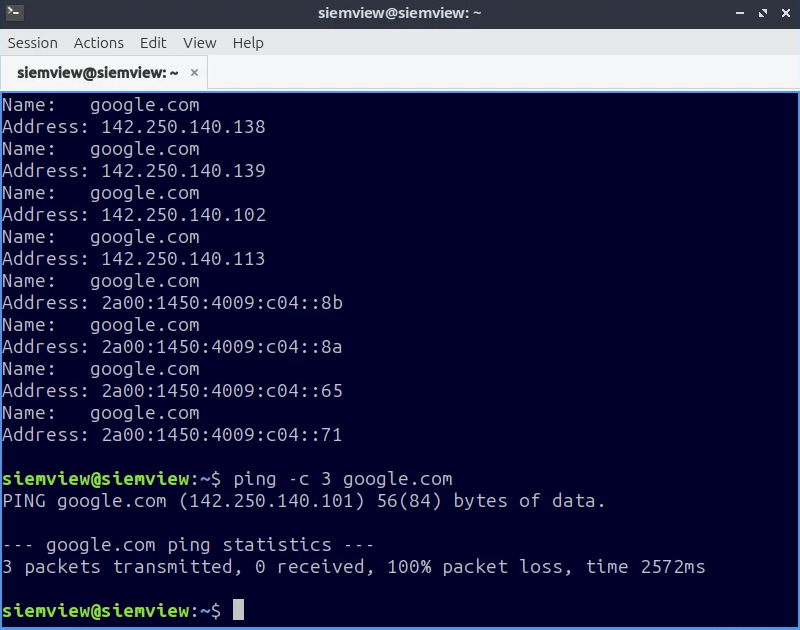

After curling the HTTPS link, it hung. When I'd made the HTTPS rule, I cloned my DNS rule but only changed the port, so the destination was still ANALYST address (the firewall itself) instead of any. I changed the destination to any, and I also set it to TCP only, since HTTPS doesn't use UDP, so leaving UDP open was just a risk.

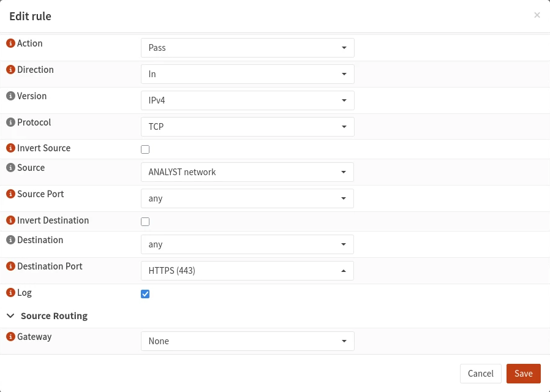

In order to download firefox, I had to use snap. When I first tried, I got `snap: command not found`, because this install didn't have snapd (the service that runs snaps). snap is a way of installing software on Ubuntu made by the company behind ubuntu. I could only  use snap to download it as Ubuntu only delivers firefox through snap.

Upon trying to install snap, it kept getting hung on an IPv6 address, while analyst-net is IPv4 only. To fix this, I ran  sudo apt -o Acquire::ForceIPv4=true install snapd
Which forces snapd to be installed through IPv4

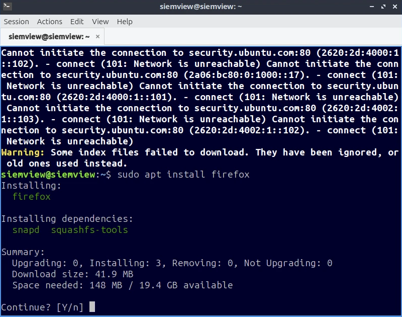

apt ended up timing out on port 80

I checked the firewall logs by going to live view, and  saw red block lines for ANALYST, 192.168.30.186 -> 91.189.x.x: 80.
This meant that the HTTP rule was missing.

I went back to the rule to set it, in which I'd realised that I'd just forgotten to apply my changes.

Then, I went back, installed snap and also installed firefox, everything was successful. I checked it was there with `snap list`.

## Backout

Upon finishing this, I went back and disabled the new rules I'd made. To test that everything still works as planned, I ran curl -I https://snapcraft.io on lubuntu. It hung, meaning that it was silently dropped, as expected. Then I ran nslookup google.com. It failed, the DNS tries to go to 192.168.30.1 and since the rule is off, packets are dropped before reaching the network.

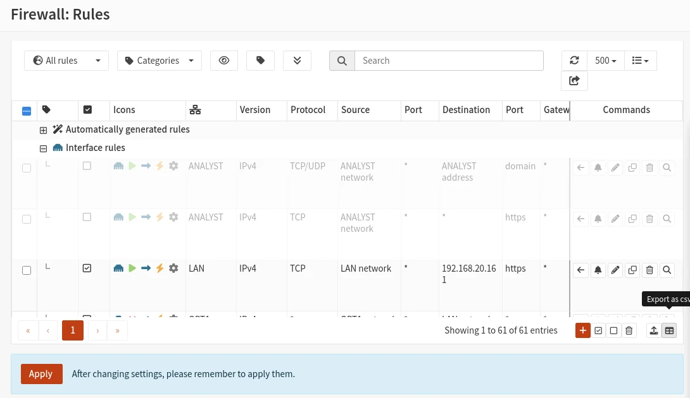

## The permanent rule

Now, I had to create a permanent rule which allowed for the analyst-net to access Wazuh through HTTPS. I chose Single host or Network so I could type the address with /32 myself. /32 means exactly one address, so the only place analyst-net can reach is the Wazuh server, and not the rest of company-net. This follows least privilege.

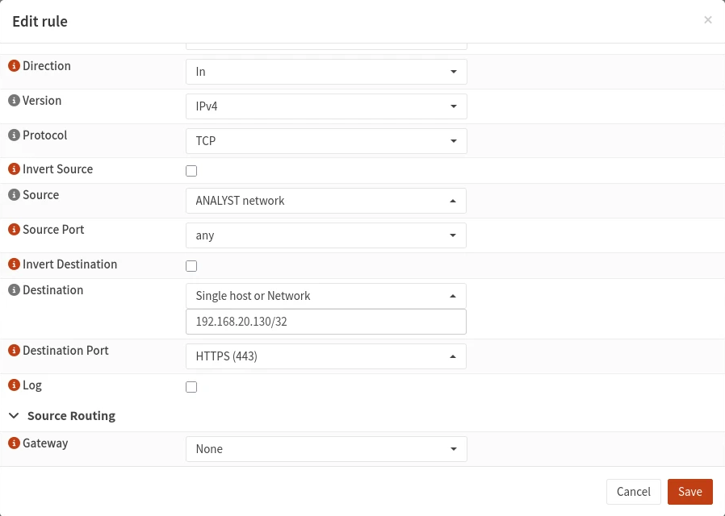 192.168.20.130/32, TCP 443" />

I set this rule, went on Firefox and entered the site name which is https://192.168.20.130. Replies from Wazuh were working, as I could see the site.

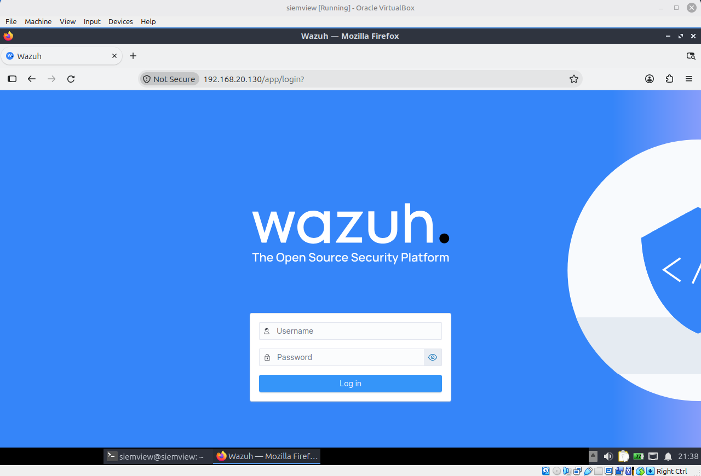

## Proving siemview can't reach the internet

To prove that siemview can't reach the internet, I tested curl -I google.com, which failed instantly with "Could not resolve host". In live view, I saw siemview trying to reach 192.168.30.1 on port 53 (DNS to the firewall), blocked by Default deny. This proved that the TEMP DNS rule was gone. But it only proved that the name lookup was blocked, not the internet itself.

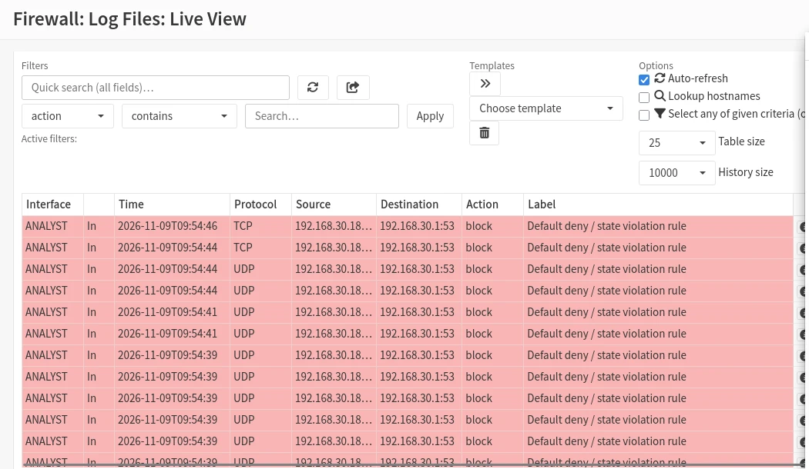

So, I skipped DNS. I got Google's IP from Kali with nslookup google.com, which was 142.250.140.139, and on siemview I ran curl -I -k https://142.250.140.139. I predicted it would hang, and it did.

To find it in live view, I filtered with dst contains 142.250.140.139. My first try didn't work, because the field box still said action and I'd added :443 on the end. Once I fixed that, I found it: interface ANALYST, direction in, TCP, port 443, label Default deny.

The block times were 1, 1, 1, 1, 1, 2, 4, 8, 16, 33 seconds apart. That's TCP retrying the connection and waiting longer each time (backoff), which is why a silent drop looks like a hang.

Traffic from siemview gets checked where it enters the firewall, which is ANALYST. The only pass rule there is to 192.168.20.130 on TCP 443, so everything else falls to Default deny and never reaches the internet.

## Checking the Wazuh rule is logging

I predicted I'd see green pass lines with my rule's label, "siemview able to access wazuh through https", when I filtered for 192.168.20.130. I opened the dashboard on siemview and searched live view for the IP, and that's what I got: ANALYST, in, TCP, 192.168.20.130:443, pass. There were lines from 7 Nov too, so logging had been on since I made the rule.

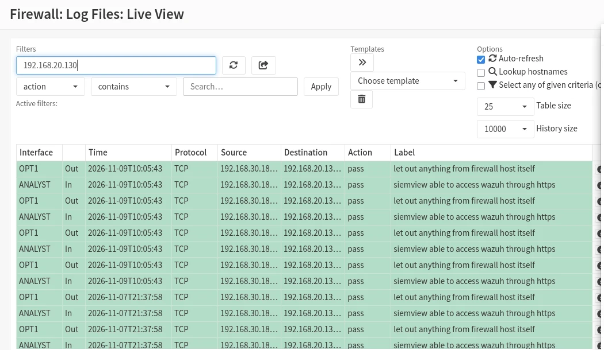

Each connection showed two lines: ANALYST in (my rule letting it in), and OPT1 out ("let out anything from firewall host itself", which is OPNsense's automatic rule for traffic leaving through a door).

## Logging in

I logged into the dashboard as admin on siemview. It showed no agents registered yet, and 4 medium and 8 low alerts from the last 24 hours. I nearly reset the password because I couldn't remember it, but it came back to me. Next time, I'll save it in a password manager before changing anything.

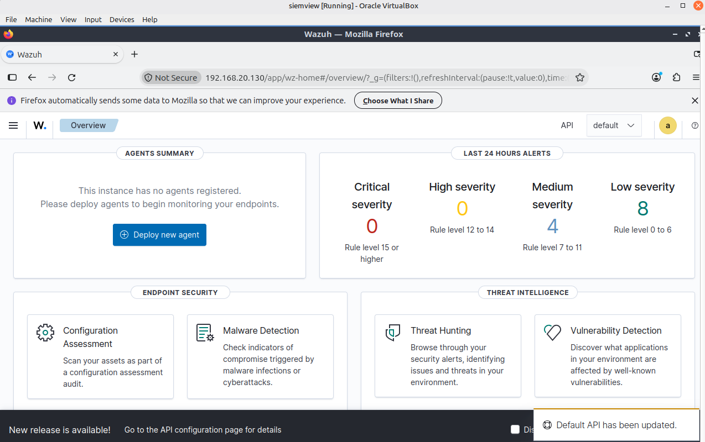

So now, siemview sits on its own network, can only reach the SIEM through one rule (ANALYST net -> 192.168.20.130 on TCP 443, logged), and has no other way out, which I proved with the DNS and direct IP tests.

## What I learnt
- Putting a /32 rule in the destination means analyst-net could only reach Wazuh, which applies the principle of least privilege.
- On modern machines, installations will most likely attempt to install applications with IPv6, which is why I had to force an IPv4 installation for my Lubuntu. My Lubuntu only had an IPv4 address, therefore IPv6 would just hang.

Next is Lab 05, putting a Wazuh agent on company-srv01.
