# Lab 05: Creating a Wazuh agent on company-srv01

In order for me to be flag down alerts,  I'll need to set up an agent that will watch and send logs to Wazuh, and Wazuh will analyse the logs and raise alerts.

Wazuh agents talk on the ports 1514 (sending events ) and 1515 (enrolment, sign up once and get a key.) Because company-srv01 and wazuh-server01 are on the same network, company-net, this traffic will never cross through OPNsense, meaning that for this practical I don't need to make any configurations to the firewall.

## First step
The first thing I done was patch the company server. Upon logging in, there was a message which said that there were 51 updates, leaving my systems unpatched would increase my attack surface, which I didn't want, as most system patches are usually security patches. I ran `sudo apt update` as an attempt to install the patches, however nothing installed, instead it refreshed the list, showing  that there were 82 patches instead. update refreshed the list, upgrade installed the patches. So then, I ran `sudo apt upgrade -y`, which worked, but it said "Pending kernel upgrade": the server was still running kernel 7.0.0-38 while 7.0.0-43 had just been installed. A new kernel only loads on a reboot, because the old one stays in memory until then, so I rebooted the server. After that, the login message showed 0 updates.

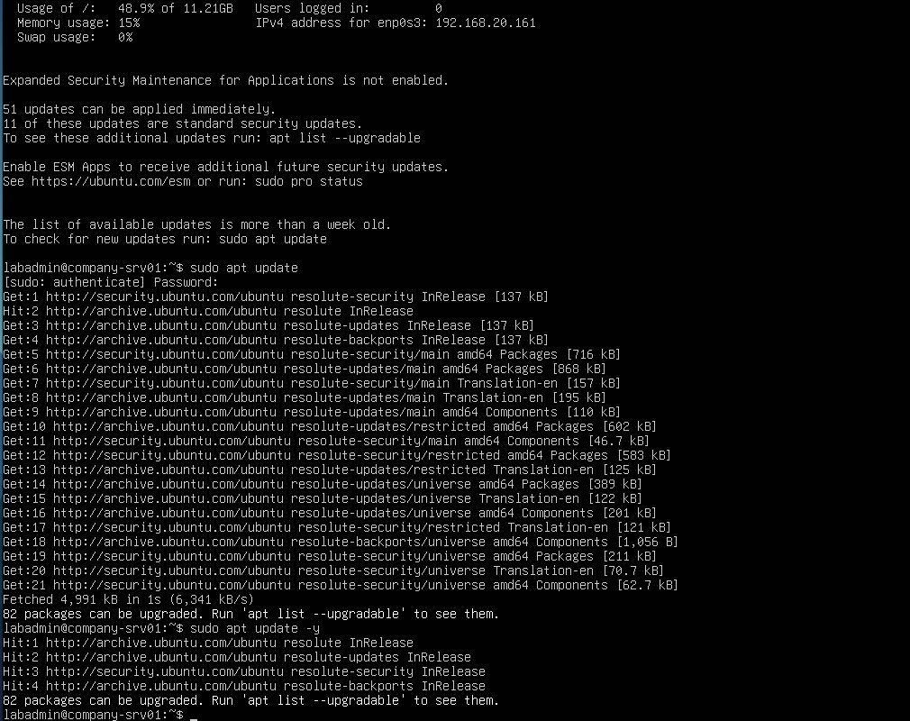

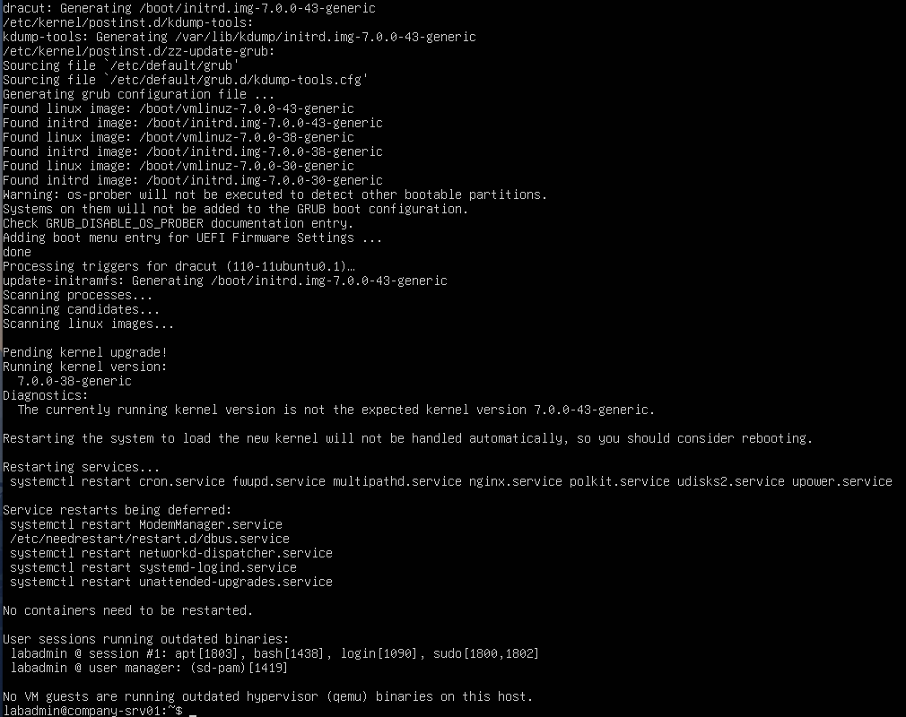

I checked which version I was on just to be sure, using `uname -r`, and it showed 7.0.0-43-generic. That was the real proof the patch worked: the server was running the new kernel, not just "install finished".

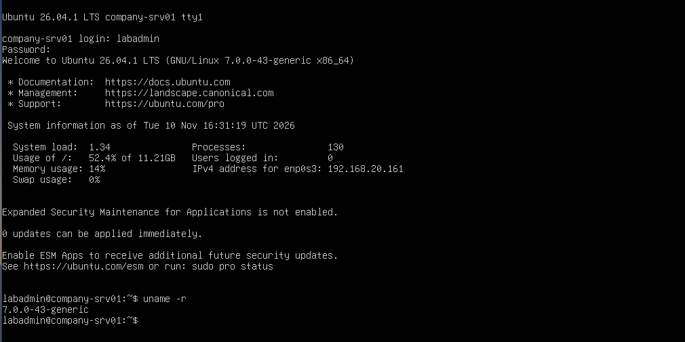

Next, I went on my siemview VM to install the agent. I clicked on add agent, and selected the DEB amd64 server and named the agent company-srv01, as that's where the agent will be able to see the logs. The agent would be acting kind of like a security camera watching a room  to see if everyone who enters is authorized to enter.

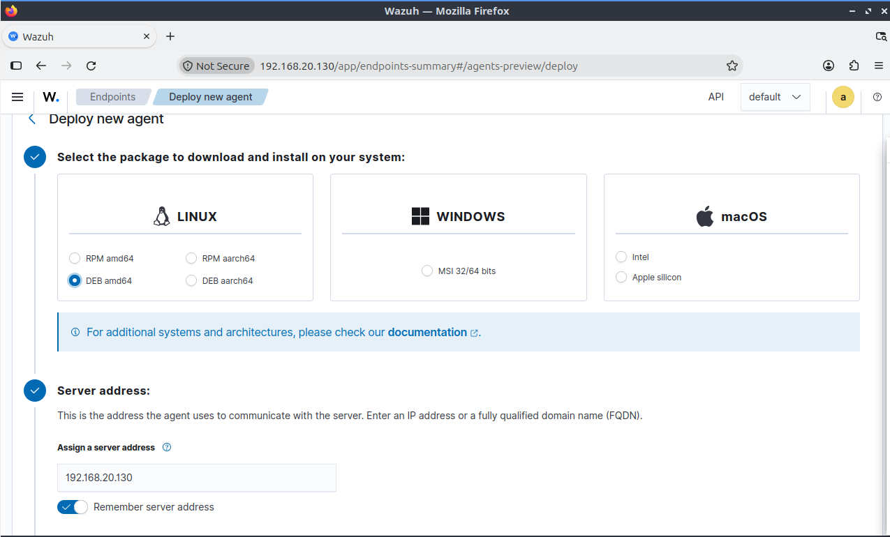

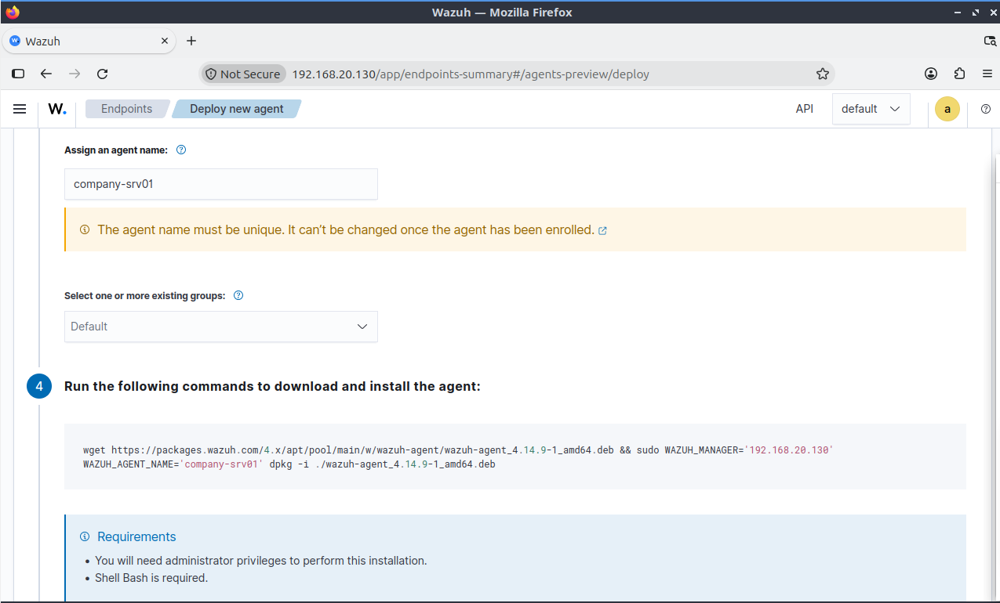

I copied the instructions that Wazuh gave me and ran `wget …wazuh-agent_4.14.9-1_amd64.deb`, then `sudo WAZUH_MANAGER='192.168.20.130' WAZUH_AGENT_NAME='company-srv01' dpkg -i ./wazuh-agent_4.14.9-1_amd64.deb`
The output ended with "Setting up wazuh-agent (4.14.9-1)", which meant dpkg installed the agent with no errors.

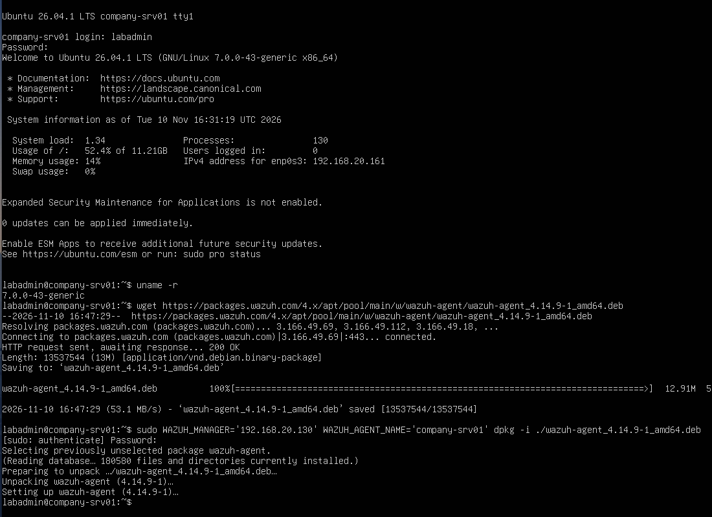

Then I ran `sudo systemctl daemon-reload && sudo systemctl enable wazuh-agent && sudo systemctl start wazuh-agent`, `enable` makes the agent start automatically every time company-srv01 boots, and `start` runs it now. I needed both.

I ran `systemctl status wazuh-agent` to check the status of wazuh-agent. It showed active (running), which meant it was started, and the Loaded line said enabled, which meant it would come back after a reboot.

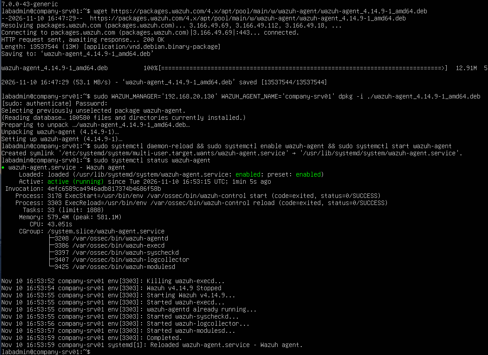

I checked the Wazuh dashboard, and it now showed me that the agent was actually up.  It showed ID 001, company-srv01, with its own IP 192.168.20.161 (the Wazuh server is .130, on the same network), Ubuntu 26.04.1 and agent version v4.14.9, which matches the Wazuh server's version. The agent must not be newer than the server.

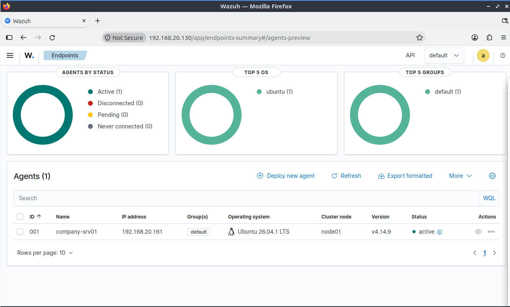

## Proving it works

Test 1: On company-srv01, I ran `ssh fakeuser@localhost` and wrote down 3 wrong passwords to see how it would show up in Wazuh. The failures went into company-srv01's `/var/log/auth.log`, and the agent sent them to the Wazuh server. Upon checking my alerts on the Wazuh dashboard on siemview (Discover), I saw `sshd: Attempt to login using a non-existent user`, **rule.level 5** from srcip 127.0.0.1 ( a loopback address as the machine is attacking itself but in a real attack, it would be the attacker's IP). Level 5 isn't too high of a level, meaning that these password failures were alerts, but low ones. However, that's a good thing , as in an organization setting, if someone were to get their password wrong accidentally, and this was a high alert, it would just be a waste of time dealing with it, and would give the analysts alert fatigue.

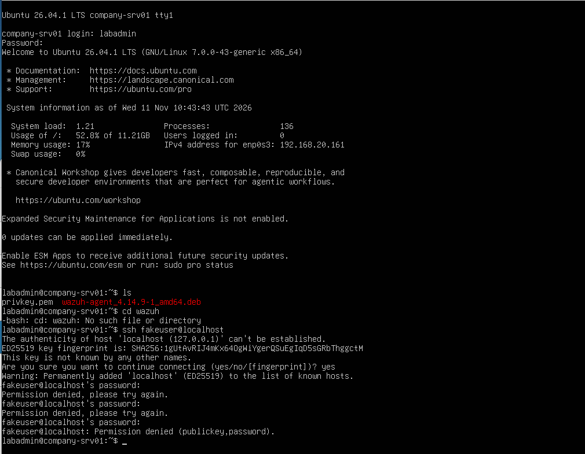

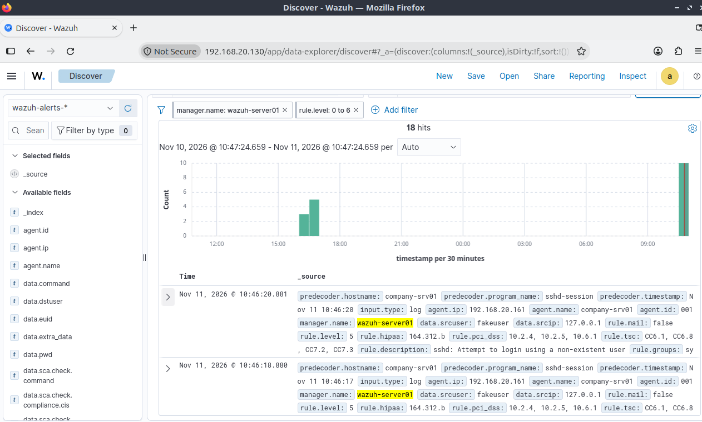

I noticed that there was a filter on my logs from level 0 - 6, which wasn't optimal. With that filter on, any alert above level 6 would have been hidden from me. I should've been able to see everything , so I closed it off, letting me see everything.

Test 2: I ran 2 more rounds of failed SSH logins, to make it seem more like a brute force attack, within a minute. Upon checking the SIEM, a new level 10 alert had fired even before reaching 9 failed logins.

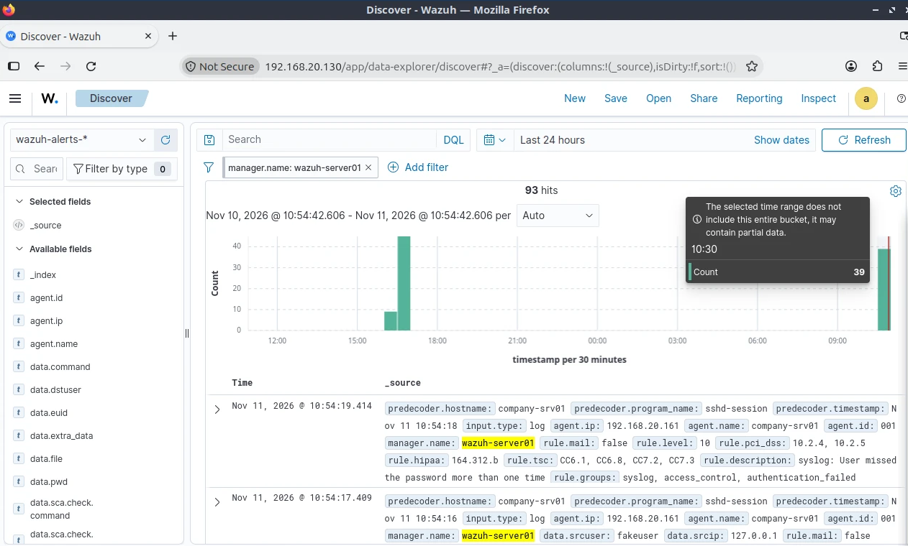

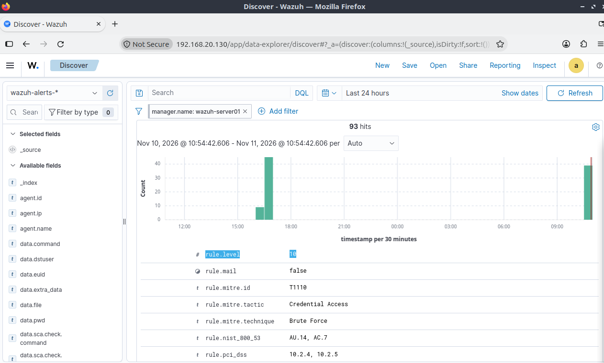

There was a new alert that said `syslog: User missed the password more than one time`, **rule.level 10**. Wazuh tagged it with **MITRE ATT&CK T1110, Credential Access, Brute Force**.

This works because of a correlation rule: Wazuh counts the level 5 failed login alerts, and when there are too many in a short time it fires a new, higher alert. One failed login is a typo, but lots of them in a minute looks like an attack.

## What I learnt

- **An agent is not the SIEM.** It's installed on the machine being watched (company-srv01) and acts like a security camera: it collects that machine's logs and sends them on. The Wazuh server is the control room that analyses them and decides what's an alert.
- **Wazuh agents use their own ports:** 1515 for enrolment (the agent signs up once and gets a key) and 1514 for sending events all the time. Because the agent and the server are on the same network, this traffic never passes through the firewall.
- **Filters can hide attacks.** A `rule.level 0 to 6` filter in Discover would have hidden the level 10 brute force alert, so I always check which filters are on before trusting what I see.