# Lab 03b: Allowing only HTTPS traffic from Kali

Started and finished 27th October 2026

## Today's goal

Kali should be able to open the website on the Ubuntu server through port 443 (HTTPS). Every other kind of access from Kali to the server should stay blocked.

The reason I'm doing this is that in Lab 03, I blocked all traffic from Kali to company-net. A real company can't just block everything, because people need to use its services. So today I'll open only the HTTPS port to one server and keep everything else blocked. This is least privilege, and it keeps the attack surface small.

## My plan for the fix

| Interface | Action | Protocol | Source | Destination | Port | Position |
|---|---|---|---|---|---|---|
| LAN | Pass | TCP | LAN network | **Single host: 192.168.20.161** | 443 (HTTPS) | Above the block rule |

Why I chose these:
- **Interface = LAN**, because firewall rules are checked on the interface where traffic comes **in**, and Kali's traffic enters the firewall on LAN.
- **Action = Pass**, because I wanted this traffic to go through.
- **Source = LAN network**, because Kali is on the LAN network (attacker-net).
- **Destination = Single host (192.168.20.161).** There was an option for "OPT1 network", but that would let Kali reach port 443 on **every** machine in company-net, including any servers added later. I only wanted it to reach the web server.
- **Port = 443 (HTTPS)**, because I only wanted Kali to reach the server through HTTPS, with every other port still blocked.
- **Position = above the block rule**, because the firewall reads rules from top to bottom and the first match wins. If it were below, the block rule would match first and HTTPS would never get through.

## Building the rule in OPNsense

I built the rule as planned above, ticked **Log** so I could see it working in the firewall log later, saved it, moved it above the block rule, and pressed **Apply**.

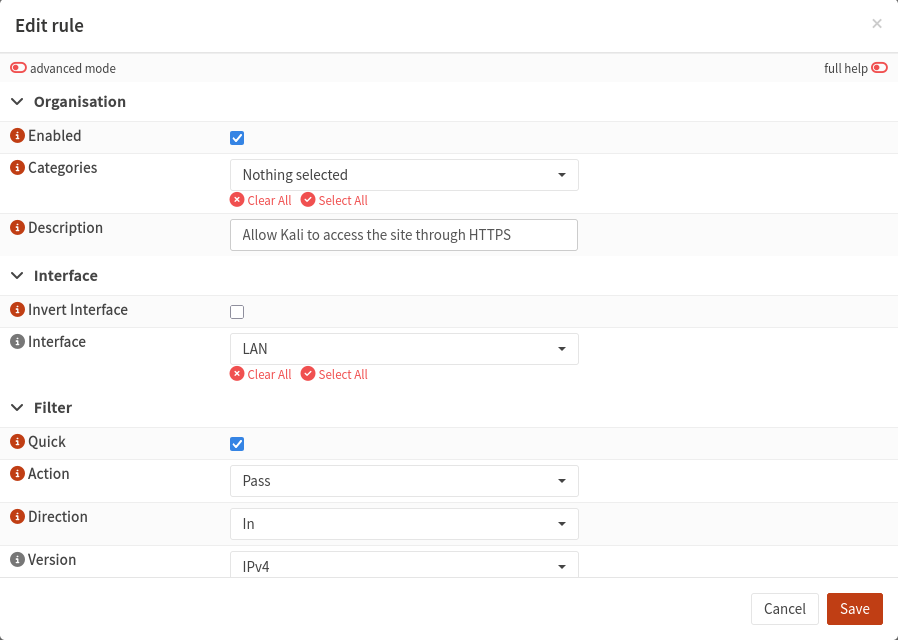
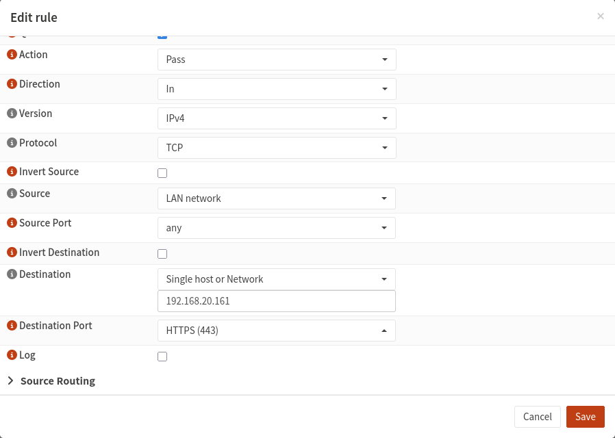
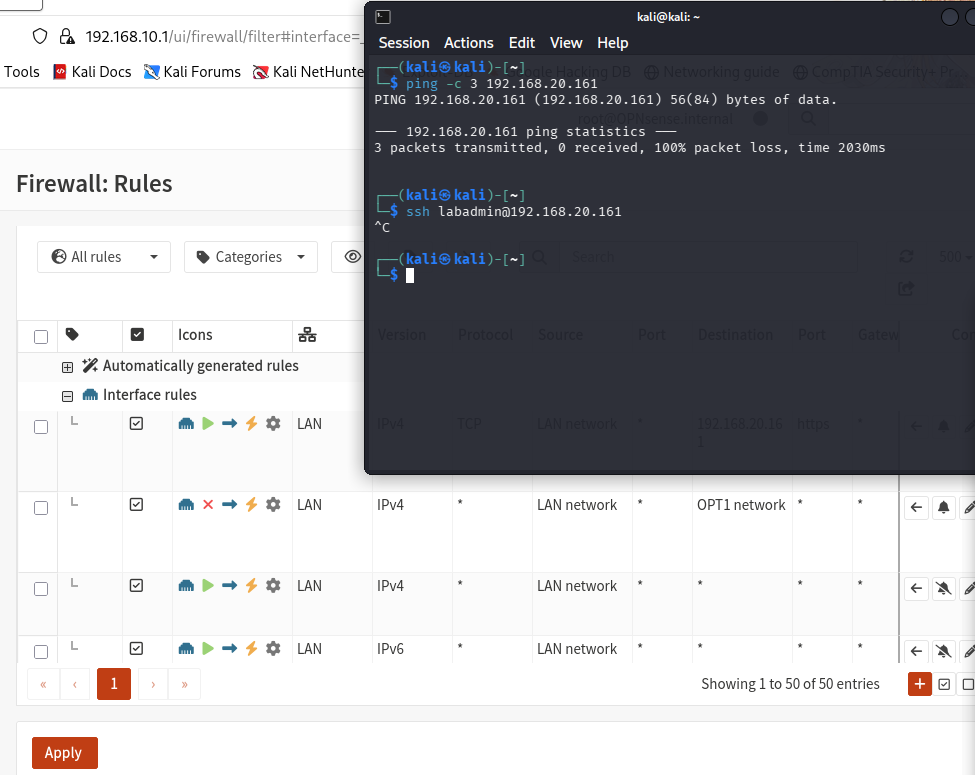

## Setting up a web server on Ubuntu

Next, I had to install a web server on Ubuntu so Kali had something on port 443 to connect to. For this, I used nginx, an app that serves websites.

I ran:

```bash
sudo apt update
sudo apt install nginx -y
systemctl status nginx
curl https://localhost
curl http://localhost
```

- `sudo apt update` refreshed Ubuntu's list of available software.
- `sudo apt install nginx -y` installed nginx (`-y` answers "yes" to the install prompt).
- `systemctl status nginx` checked that it was running. The green **enabled** and **active (running)** showed it worked.
- The two `curl` commands tested whether the website was up. HTTPS failed, which was expected, because nginx only listens on port 80 (HTTP) when it's first installed. HTTP worked and returned the "Welcome to nginx!" page.

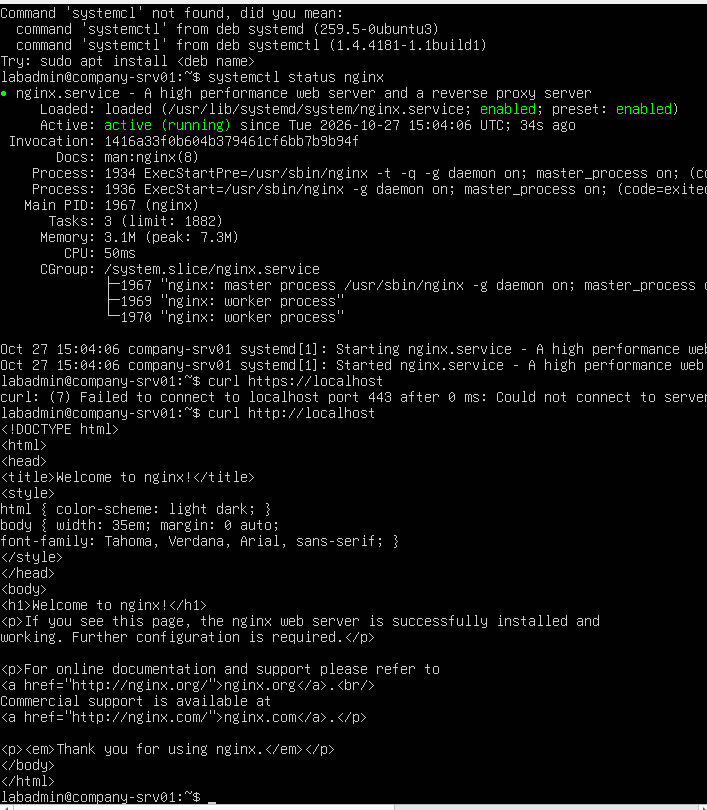

## Turning on HTTPS

To be honest, I didn't know how to do this part or why it was needed, so I used AI (Claude) to help me with it, and then made sure I understood each step.

HTTPS needs two things: a **certificate** and a **private key**, which I hadn't set up on the Ubuntu server. Ubuntu already comes with one called **snakeoil**, a certificate it makes for itself when it's installed. It's **self-signed**, so browsers don't trust it, but the traffic is still encrypted, which is fine for a lab.

I ran:

```bash
ls /etc/ssl/certs/ssl-cert-snakeoil.pem
sudo nano /etc/nginx/sites-available/default
```

- `ls /etc/ssl/certs/ssl-cert-snakeoil.pem` checked that the snakeoil certificate was there.
- `sudo nano /etc/nginx/sites-available/default` opened nginx's config file, the instruction sheet that tells nginx how to run the website and which ports to listen on.

In the config, I removed the `#` (which switches a line off) from two lines:
- `listen 443 ssl default_server;` tells nginx to also open port 443 for HTTPS.
- `include snippets/snakeoil.conf;` tells nginx which certificate and key to use on that port.

Then I ran:

```bash
sudo nginx -t
sudo systemctl reload nginx
curl -k https://localhost
```

- `sudo nginx -t` checked the config for mistakes, so I knew I hadn't broken anything.
- `sudo systemctl reload nginx` made nginx load the new config.
- `curl -k https://localhost` tested HTTPS. `-k` tells curl to accept the self-signed certificate. It returned the "Welcome to nginx!" page, so nginx now served the site over both HTTP and HTTPS.

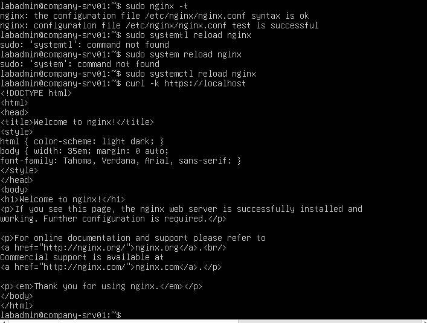

## Testing from Kali

Before testing, I wrote down what I expected each test to do.

First, I pinged Ubuntu from Kali: 100% packet loss, as expected. Then I tried SSH with `ssh labadmin@192.168.20.161`, which just hung with no reply, so it was blocked too.

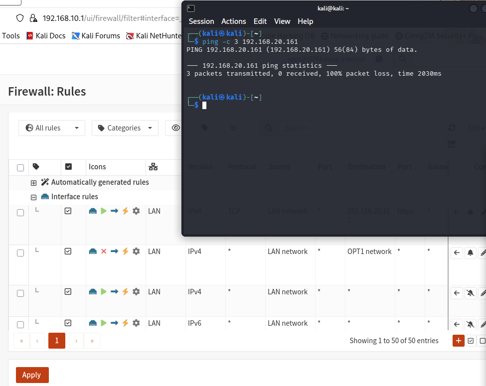

Next, I tried to reach the site over HTTP (port 80) with `curl -m 5 http://192.168.20.161`. As expected, it timed out. (`-m 5` makes curl give up after 5 seconds.)

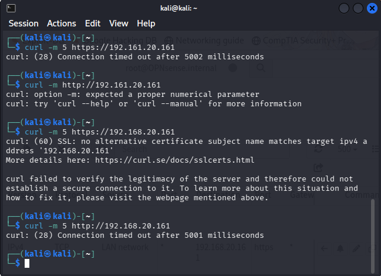

Then HTTPS. I hadn't known that without the `-k` option, curl refuses a self-signed certificate, so my first try failed with a certificate error. I tried opening the site in Firefox instead, and got a certificate warning. This actually meant it was a success: you can only get a certificate warning once you've reached the server, because the certificate comes from the server. If the firewall had blocked me, it would have just timed out. I then ran curl again with `-k`, and it returned the "Welcome to nginx!" page.

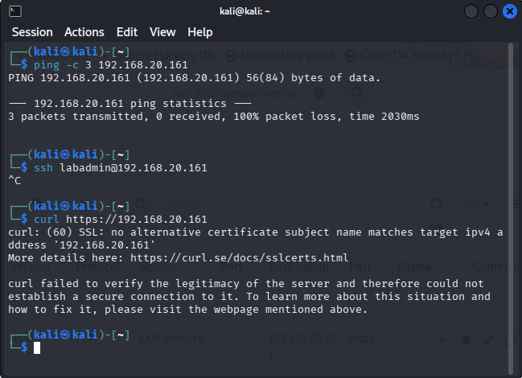
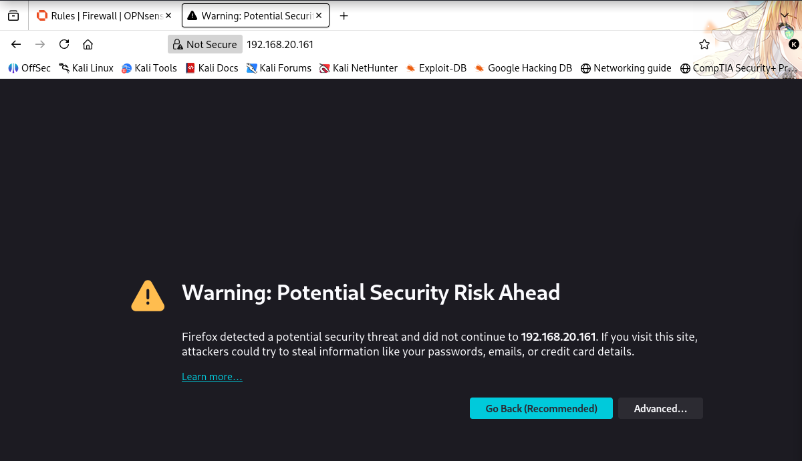
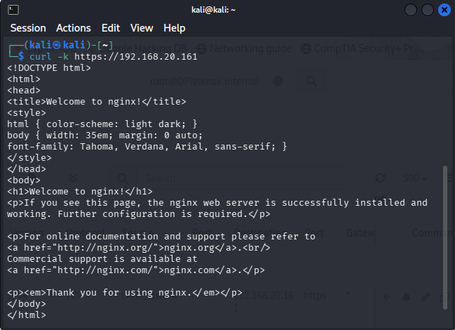

| Test | Command | Expected | Result |
|---|---|---|---|
| Ping | `ping -c 3 192.168.20.161` | Blocked | Blocked: 100% packet loss |
| SSH (port 22) | `ssh labadmin@192.168.20.161` | Blocked | Blocked: no reply |
| HTTP (port 80) | `curl -m 5 http://192.168.20.161` | Blocked | Blocked: timed out after 5 seconds |
| HTTPS (port 443) | `curl -k https://192.168.20.161` | Works | Works: Welcome to nginx! |

## Proof in the firewall log

To prove it from the firewall's side, I opened Firewall → Log Files → Live View and reran the tests. I saw 5 red lines: my block rule, "block attacker-net from reaching company-net", blocking Kali (192.168.10.142) from reaching Ubuntu (192.168.20.161). These are the details of one of those blocks:

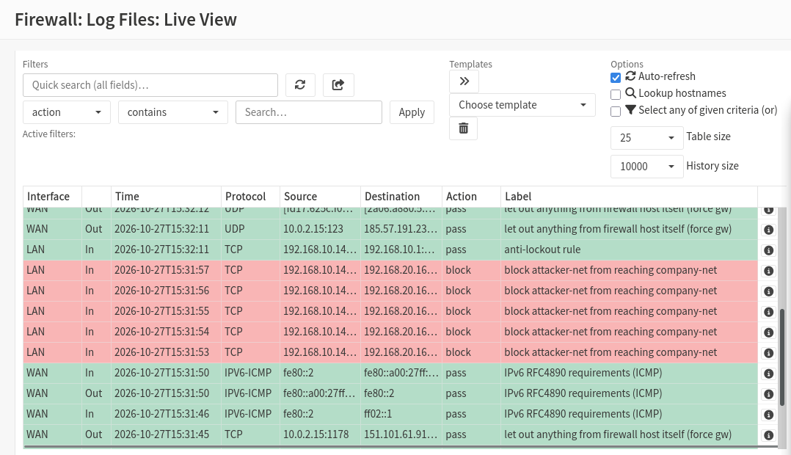
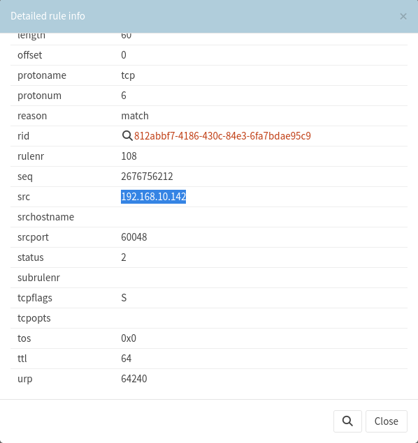

The `S` in `tcpflags` means **SYN**, the first packet of the TCP handshake (SYN → SYN-ACK → ACK). Kali only ever sent the SYN and never got a SYN-ACK back, because the firewall dropped it. The handshake never started, which is why SSH and curl just hung.

Then I checked for the pass: a green line from Kali to Ubuntu on TCP, labelled with my new rule, "Allow Kali to access the site through HTTPS". That's my rule letting port 443 through.

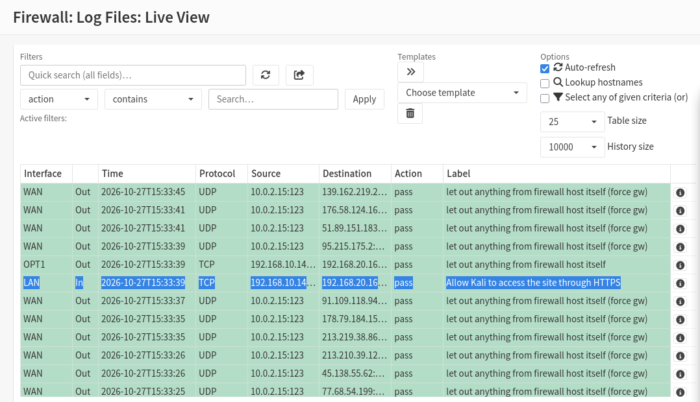

## Findings

- Kali can reach the website on Ubuntu over HTTPS (443) only. Ping, SSH and HTTP (80) are still blocked.
- The firewall log proves it: a green pass on my 443 rule, and red blocks (dropped SYNs) on the block rule.

## What I learned

- How to use nginx to set up a web server.
- How to turn on HTTPS in nginx using Ubuntu's built-in self-signed (snakeoil) certificate.
- curl refuses a self-signed certificate by default; `-k` tells it to accept it anyway.
- I chose a single host as the destination so Kali can only reach port 443 on the web server, not on every other device in company-net that has that port open.
- A certificate warning proves HTTPS was available and that the firewall let me through, because the certificate comes from the server itself.
- `tcpflags S` in a block line means only the SYN was sent; the handshake never finished because the firewall dropped it.

## Next

Lab 04: setting up a Wazuh SIEM to collect logs from my lab and alert on suspicious activity.
